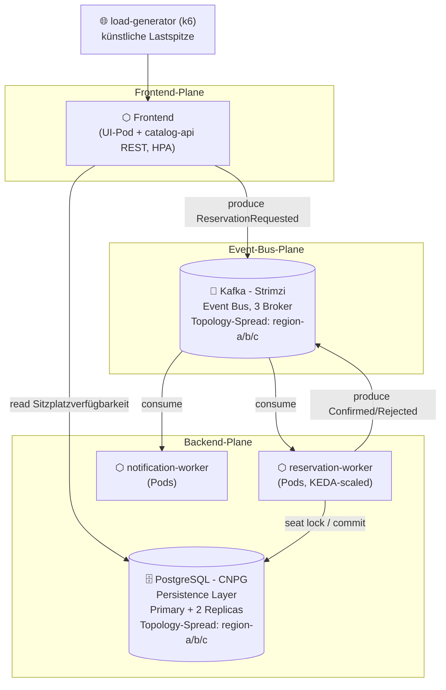

# TicketFlow

Cloud-native Ticketverkaufsplattform für Live-Events. Prüfungsleistung "Cloud Infrastructures and
Cloud Native Applications", DHBW. Dieses Dokument ersetzt den schriftlichen Bericht vollständig.

## ToDo

### 23.06.2026

P3 -> Niklas prüfen
P4 -> Jeder für sein Helm Chart prüfen
P5 -> Jeder für sein Helm Chart prüfen
W2 -> Niklas prüft ob das passt (sollte bereits fertig sein)
B3 -> neue technologie Kafka, bereits umgesetzt -> muss noch endgültig dokumentiert werden
B4 -> Entscheidung welches Wahlthema wir nehmen W1 oder W7
Wollen wir noch B2 machen für die Bonuspunkte -> ja zumindest dokumentieren, die Punkte kann man mitnhehmen


Pfisterer:
- Application
   - Frontend -> Philipp
      - Buchungsseite, Sitzplatzauswahl, Anzeige Bestätigung, Fehlermeldung, Datenbank Info welche PLätze belegt, Session ID Kundenunterscheidung
   - API + Kafka Producer -> Philipp
   - Kafka Consumer -> Carlos
      - DB Schema aufbauen und über applikation versionieren
      - Event verarbeitung mit Reservierung des sitzplatzes, anschließend event ob successfull oder nicht
   - Message service -> Niklas
- Kafka Cluster -> Carlos
   - Schema Registry
   - Kafka Cluster
   - AKHQ als Oberfläche
- Postgres Cluster -> Niklas


Für alle Applikationen:
- Scheduling und Platzierung der Pods
- Resilienz der deployments
- Requests und Limits checken
- Helm Chart mit Values Schema

Bonus:
- Helm Charts
- Packaging von Helm Charts
- Kafka Strimzi
- Chaos Experiment


Screen Cast:
Alle Zusammen


- Observability mit OpenTelemetry
   - Logging
   - Metriken
   - evtl. Traces
- Autoscaler

Sturm:
Beleuchten Sie die ihnen zugeteilte Laborarbeit auf der Basis der in der Vorlesung
vermittelten theoretischen Grundlagen:
− Welche Vorteile und Nachteile ergeben sich für Ihre Anwendung aus der Realisierung
als Cloud Native? Zeigen Sie dabei auch alternative Realisierungsmöglichkeiten auf,
stellen Sie diese Ihrer Cloud Native Lösung gegenüber und erörtern Sie kritisch.
Unterlegen sie ihrer Argumentation mit konkreten Beispielen.
− Wie gewährleisten Sie die Datensicherheit? Bewerten Sie dabei auch die Relevanz der
DSGVO für Ihre Anwendung.
− Skizzieren und begründen Sie abschließend welche Cloud Native Pattern sich wo in
ihrer Anwendungsarchitektur wiederfinden.

Alea macht einen ersten Wurf
 

> **Status:** Repository-Grundgerüst. Diese README beschreibt die geplante und im Aufbau
> befindliche Architektur; Abschnitte, die noch nicht final implementiert sind, sind mit `TODO`
> markiert. Jeder Ordner enthält eine eigene README mit Detailplanung.

## Problem

Beim Vorverkauf populärer Events (Konzert, Stadion-Match) starten tausende Nutzer innerhalb
weniger Sekunden denselben Kaufversuch für eine kleine, feste Anzahl an Plätzen. Ein klassischer
synchroner CRUD-Ansatz (Request → sofortiger DB-Write) macht die Datenbank zum Flaschenhals:
Nutzer sehen Timeouts statt einer fairen Reihenfolge, und Plätze werden im Zweifel doppelt
vergeben (Overselling). TicketFlow trennt die *Annahme* einer Reservierungsanfrage von deren
*Verarbeitung* über einen Message Bus und skaliert die Verarbeitung anhand der Warteschlangenlänge
nach. Genau dieser Lastpfad – "viele gleichzeitige Reservierungen für ein knappes Kontingent" –
ist der fachliche Grund, warum Queue, Datenbank und Autoscaling hier tatsächlich gebraucht werden,
nicht nur vorgeführt.

## Architektur



**Datenfluss von der VM bis zum Pod:**

1. Terraform/OpenTofu erzeugt gegen den OpenStack-Provider der DHBWCloud vier VMs (1
   Control-Plane, 3 Worker) direkt am vorhandenen, extern routbaren Projektnetz `DHBWV6` – kein
   eigenes Netz, kein Router, keine selbst verwaltete Security Group — siehe
   [`infra/terraform/`](infra/terraform/). Jeder Worker erhält eine virtuell simulierte
   Regions-Metadata (`region-a`/`region-b`/`region-c`), da die DHBWCloud real nur eine
   Region/AZ bereitstellt.
2. Ansible konfiguriert die VMs, installiert k3s (Server auf der Control-Plane, Agents auf den
   Workern), übernimmt die simulierte Region als Kubernetes-Node-Label
   (`topology.ticketflow/region`) und bootstrapt ArgoCD — siehe [`infra/ansible/`](infra/ansible/).
3. ArgoCD übernimmt ab hier per GitOps den Rest: ein einziges `ApplicationSet`
   ([`gitops/applicationset.yaml`](gitops/applicationset.yaml)) erzeugt alle 19 Applications —
   CNPG-Operator, Strimzi-Operator, KEDA, kube-prometheus-stack und die TicketFlow-Charts selbst.
   Alle deployment-spezifischen Werte kommen dabei aus der zentralen
   [`gitops/env/cluster.yaml`](gitops/env/cluster.yaml) — siehe [`gitops/`](gitops/).
4. `catalog-api` nimmt Reservierungsanfragen entgegen und veröffentlicht sie als Event auf Kafka,
   statt synchron in die Datenbank zu schreiben.
5. `reservation-worker` konsumiert diese Events, sperrt den Sitzplatz transaktional in CNPG-Postgres
   und veröffentlicht das Ergebnis (bestätigt/abgelehnt) wieder auf Kafka.
6. `notification-worker` konsumiert das Ergebnis und simuliert eine Bestätigungs-Benachrichtigung.
7. Der `load-generator` erzeugt künstlich die namensgebende Lastspitze; Prometheus/Grafana machen
   Backlog, Fehlerquote und Replica-Anzahl sichtbar, KEDA reagiert auf den Kafka-Consumer-Lag.

Detailskizze und Screenshots des tatsächlichen Deployments folgen in
[`docs/architecture/`](docs/architecture/) (`TODO`, sobald der Cluster steht).

## Betrieb

Das gesamte Deployment wird über **eine** git-getrackte Konfigurationsdatei gesteuert:
[`gitops/env/cluster.yaml`](gitops/env/cluster.yaml). Sie wird von Terraform, Ansible, ArgoCD und
allen Helm-Charts gelesen — Fork-URL, DNS-Zone, ACME-Kontakt, Image-Registry, Image-Tag und die
Umgebung (`dev`/`prod`) stehen dort jeweils genau einmal. Nur echte Geheimnisse liegen daneben, in
zwei gitignorierten Dateien.

### Einmalig je Fork

Diese Schritte lassen sich nicht aus dem Repo heraus automatisieren:

1. **Repo forken** unter dem eigenen GitHub-Account, **privat** (siehe
   [`gitops/README.md`](gitops/README.md) ## Privates Repo).
2. **Python-venv** für Ansible anlegen — muss aus WSL/Linux laufen, nicht aus nativem Windows
   (`ansible-core` scheitert dort mit `WinError 87`):
   ```bash
   python3 -m venv .venv && source .venv/bin/activate
   pip install -r infra/ansible/requirements.txt
   ```
3. **SSH-Keypair für die VMs**: `~/.ssh/ticketflow_dhbwcloud{,.pub}` (Terraform importiert den
   Public Key; Pfade sind über `ssh_public_key_path`/`ssh_private_key_path` änderbar).
4. **DNS-Zone registrieren** auf `self-service.dhbw.cloud` mit RFC2136-Freigabe. Notiert werden
   Zonenname, TSIG-Key-**Name** und TSIG-Secret-**Wert**.
5. **ArgoCD-Deploy-Key erzeugen** und den Public Key im eigenen Fork unter *Settings → Deploy keys*
   als **Read-only** eintragen — ohne ihn kann ArgoCD das private Repo nicht klonen und alle
   Applications bleiben `Unknown`:
   ```bash
   ssh-keygen -t ed25519 -C "argocd-deploy-key@ticketflow" \
     -f infra/ansible/argocd_deploy_key -N ""
   cat infra/ansible/argocd_deploy_key.pub
   ```
6. **Images bauen lassen**: Workflow `build-images` in *Actions* einmal manuell starten
   (`workflow_dispatch`). Ein frischer Fork hat sonst noch keine Images, und alle vier Services
   landen im `ImagePullBackOff`.
7. **Die vier ghcr.io-Packages auf „Public" stellen** (GitHub → Packages → jeweils *Package
   settings*). Der eingebaute `GITHUB_TOKEN` kann das nicht selbst setzen; bis dahin scheitert der
   Pull trotz korrektem Tag.
8. **DHBW-Netz/VPN**: `certificates.dhbw.cloud` (ACME) ist nur von dort erreichbar.

### Konfigurieren

```bash
# 1. Zentrale Konfiguration - die einzige git-getrackte Datei, die angefasst werden muss
$EDITOR gitops/env/cluster.yaml
#    repoURL, dnsZone, acmeEmail, rfc2136.keyName, imageRegistry, namePrefix

# 2. Die eine Repo-URL im git-Generator des ApplicationSet (Henne-Ei, siehe Kommentar dort)
$EDITOR gitops/applicationset.yaml

# 3. Committen UND in den eigenen Fork pushen.
#    ArgoCD liest ausschliesslich den Remote-Stand von targetRevision - ein lokal geaenderter,
#    ungepushter Stand wird nie ausgerollt.
git commit -am "chore: configure deployment" && git push

# 4. Geheimnisse (beide gitignored, je eine .example-Vorlage daneben)
cp infra/terraform/terraform.tfvars.example infra/terraform/terraform.tfvars
#    -> OpenStack-Application-Credentials, Region, Image, Flavors
cp infra/ansible/secrets.yml.example infra/ansible/secrets.yml
#    -> rfc2136_tsig_secret_value (der WERT, nicht der Key-Name)
```

### Ausrollen

```bash
# 1. Infrastruktur auf der DHBWCloud erzeugen (generiert auch inventory/hosts.ini)
cd infra/terraform
terraform init
terraform apply

# 2. VMs konfigurieren, k3s aufbauen, ArgoCD bootstrappen, GitOps-Secrets anlegen.
#    Der letzte Schritt wendet gitops/applicationset.yaml an - alles Weitere rollt ArgoCD aus.
cd ../ansible
ansible-inventory -i inventory/hosts.ini --list
ansible-playbook playbooks/site.yml
#    -> das initiale ArgoCD-Admin-Passwort steht in der Playbook-Ausgabe

# 3. Rollout prüfen (aus dem Repo-Wurzelverzeichnis)
cd ../..
export KUBECONFIG=infra/ansible/kubeconfig
kubectl -n argocd get applicationset ticketflow
kubectl -n argocd get applications          # 19 Stueck, alle Synced/Healthy
kubectl get pods -A -o wide
kubectl get kafka,cluster.postgresql.cnpg.io -A

# 4. Künstlichen Lastpfad auslösen
cd src/load-generator
k6 run flash-sale.js --env API_URL=https://ticketflow.<dns-zone> --env EVENT_ID=demo-konzert --env VUS=500 --env DURATION=3m

# 5. Beobachten
kubectl port-forward svc/kube-prometheus-stack-grafana 3000:80 -n monitoring
# -> Dashboard "TicketFlow Overview" öffnen
```

Von `dev` auf `prod` (mehr Replicas, Topology-Spread mit Wirkung, engere PodDisruptionBudgets)
schaltet eine einzige Zeile um — `ticketflow.environment` in `gitops/env/cluster.yaml`. Das
ApplicationSet zieht daraufhin für jeden Chart die passende `values-<env>.yaml`.

Ein frisch erzeugtes Projekt auf der DHBWCloud muss allein mit diesen Schritten zum laufenden
Stack führen.

### Lokale Entwicklung (catalog-api + frontend)

Rein für die Entwicklung von `catalog-api`/`frontend`, kein Teil des obigen Cluster-Pfads:

```bash
docker compose up -d --build
# frontend: http://localhost:8081, catalog-api: http://localhost:8080
docker compose down -v
```

Postgres/Kafka laufen dabei als lokale Stand-ins für CNPG/Strimzi (Seed-Daten aus
`local/postgres/init.sql`). `reservation-worker` läuft im selben Compose-Stack mit (baut sein
eigenes DB-Schema beim Start über versionierte Migrationen auf, siehe
`src/reservation-worker/README.md`) und verarbeitet die Buchung bis `confirmed`/`rejected` durch
— die Kafka-Message (`ReservationRequested`) lässt sich trotzdem direkt prüfen:

```bash
docker exec $(docker compose ps -q kafka) /opt/kafka/bin/kafka-console-consumer.sh \
  --bootstrap-server localhost:29092 --topic reservation-requested --from-beginning
```

## Entscheidungen

Je Pflicht- und Wahlthema: Wahl, Alternative, Begründung.

**P1 – Anwendung und Domäne.** *Wahl:* drei eigene Services (`catalog-api`,
`reservation-worker`, `notification-worker`) plus CNPG-Postgres und Strimzi-Kafka als
zustandsbehaftete Dienste. *Alternative:* ein einzelner Monolith mit synchronem DB-Zugriff.
*Begründung:* Erst die Trennung von Annahme (API) und Verarbeitung (Worker) über eine Queue macht
den Lastpfad des Flash-Sales beherrschbar und erlaubt, genau den Engpass-Service unabhängig zu
skalieren. `catalog-api` selbst ist in Go + `chi` umgesetzt (schreibt bewusst nie synchron in
Postgres, nur lesend + Kafka-Producer, siehe `src/catalog-api/README.md`), damit dieselbe
Toolchain wie im geplanten `reservation-worker` zum Einsatz kommt und das Image im Flash-Sale-Pfad
klein/schnell startend bleibt. *Alternative:* Python + FastAPI (schnelleres Prototyping, aber
größeres Image und eine zweite Toolchain neben Go).

**P2 – Infrastruktur als Code.** *Wahl:* Terraform/OpenTofu gegen den OpenStack-Provider für
VMs/Netz, Ansible für OS-Konfiguration und k3s-Bootstrap — ein `terraform apply` gefolgt von einem
`ansible-playbook site.yml` bringt den kompletten Stack hoch. *Alternative:* manuell im
DHBWCloud-Portal angelegte VMs, oder ein anderes IaC-Werkzeug (z. B. Pulumi) statt der
vorgeschlagenen Kombination. *Begründung:* Ein Portal-Klick wäre schneller, ließe sich aber nicht
reproduzieren und zählt laut Aufgabenstellung explizit nicht als Nachweis ("kein Klick im
Portal"); Managed Kubernetes ist auf der DHBWCloud ohnehin ausgeschlossen. Terraform+Ansible trennt
zusätzlich sauber "Ressourcen existieren" (Terraform, siehe
[`infra/terraform/`](infra/terraform/)) von "Ressourcen sind konfiguriert" (Ansible, siehe
[`infra/ansible/`](infra/ansible/)) — ein einzelnes Werkzeug für beides würde diese Trennung
verwischen und macht schwerer nachvollziehbar, welcher Schritt für einen fehlgeschlagenen Bootstrap
verantwortlich ist.

**P3 – Deployment und Konfiguration.** *Wahl:* Helm-Werte legen Requests/Limits je Service fest
(z. B. `notification-worker`: 25m/100m CPU, 32Mi/64Mi Memory — bewusst klein, weil der Dienst nur
Kafka-Konsum und kurze Log-/SMTP-Aufrufe macht, keine CPU-intensive Verarbeitung wie
`reservation-worker`; siehe [`charts/notification-worker/values.yaml`](charts/notification-worker/values.yaml)),
Images werden mit dem Git-SHA statt `:latest` getaggt, DB-Zugangsdaten/Kafka-Bootstrap-Server
kommen aus ConfigMap/Secret. *Alternative:* Werte im Image hart kodieren oder `:latest`
verwenden. *Begründung:* `:latest` macht Rollbacks unmöglich, weil unklar bleibt, welches Image zu
einem Zeitpunkt tatsächlich lief; Secrets im Image wären sowohl in der Registry einsehbar als auch
nicht pro Umgebung (dev/prod, siehe W1) austauschbar, ohne das Image neu zu bauen.

**P4 – Scheduling und Platzierung.** *Wahl:* Jeder Worker trägt ein Node-Label
`topology.ticketflow/region` (`region-a`/`region-b`/`region-c`, von Terraform als Metadata
vergeben und von Ansible in ein Kubernetes-Label übersetzt – die DHBWCloud stellt real nur eine
Region/AZ bereit, die Verteilung wird für diese Entscheidung bewusst simuliert). CNPG-Postgres
(Primary+2 Replicas) und Kafka (Strimzi, je 3 Broker und 3 KRaft-Controller — auch im aktiven
dev-Profil, siehe [`charts/kafka-cluster/values-dev.yaml`](charts/kafka-cluster/values-dev.yaml))
erhalten je eine `topologySpreadConstraint`/`podAntiAffinity` auf diesem Label, sodass ihre Replicas
nie auf demselben simulierten Standort landen. Für Kafka ist das eine **harte** Regel
(`whenUnsatisfiable: DoNotSchedule`,
[`kafka-broker-nodepool.yaml`](charts/kafka-cluster/templates/messaging/kafka-broker-nodepool.yaml)):
Das Topic `reservation-requested` ist der Puffer aller Flash-Sale-Anfragen, jede Partition liegt
dreifach vor und verlangt zwei bestätigte Kopien (`min.insync.replicas: 2`). Lägen zwei Broker in
derselben Region, würde deren Ausfall genau diese Mehrheit mitnehmen und `catalog-api` müsste
Reservierungen abweisen — dann lieber ein sichtbar `Pending` bleibender Broker als ein stilles
Zusammenrutschen. Requests/Limits sind je Chart hergeleitet statt geschätzt: Kafka-Broker
1Gi Memory (Request = Limit, weil ein OOM-Kill bei einem zustandsbehafteten Broker Log-Recovery und
Leader-Wechsel auslöst) bei explizit 512m JVM-Heap — Kafka hält Nachrichten im OS-Page-Cache, nicht
im Heap —, `reservation-worker` nur 25m CPU/48Mi, weil er I/O-gebunden auf Postgres wartet und KEDA
bis zu zehn Kopien gleichzeitig einplant; die Rechnung steht jeweils als Kommentar in
[`charts/kafka-cluster/values.yaml`](charts/kafka-cluster/values.yaml) und
[`charts/reservation-worker/values.yaml`](charts/reservation-worker/values.yaml). *Nachweis im
Betrieb:* `kubectl get nodes -L topology.ticketflow/region` neben
`kubectl -n kafka get pods -l strimzi.io/cluster=ticketflow-kafka -o wide` zeigt je einen Broker und
Controller pro Region. Alle zustandslosen App-Pods (`catalog-api`, `frontend`,
`reservation-worker`, AKHQ, Apicurio) tragen dieselbe weiche Praferenz (`whenUnsatisfiable:
ScheduleAnyway` bzw. eine `preferred`-`podAntiAffinity` dort, wo der jeweilige Helm-Chart kein
natives `topologySpreadConstraints`-Feld anbietet, z. B. AKHQ) — wirkungslos, solange ein Dienst
nur mit einer Replica läuft, greift aber sofort, sobald KEDA `reservation-worker` hochskaliert
oder `catalog-api`/`frontend` mit `replicaCount: 2` (dev) bzw. `3` (prod) laufen. Auch deren
Requests/Limits sind hergeleitet: `catalog-api` 50m/64Mi Request (I/O-gebunden zwischen DB-Read
und Kafka-Produce, kaum CPU im Leerlauf) mit 300m/128Mi Limit als Kopfraum für die
JSON-Schema-Validierung vor jedem Kafka-Publish; `frontend` nur 10m/16Mi Request (liefert nur
statische Dateien aus) mit 100m/64Mi Limit für viele gleichzeitige Verbindungen beim
Vorverkaufsstart — Begründung jeweils als Kommentar in
[`charts/ticketflow-app/values.yaml`](charts/ticketflow-app/values.yaml). *Nachweis im Betrieb:*
`kubectl -n ticketflow get pods -l app.kubernetes.io/component=catalog-api -o wide` (bzw.
`=frontend`) neben `kubectl get nodes -L topology.ticketflow/region` zeigt die Verteilung über die
drei Regionen, sobald mehr als eine Replica läuft.
*Alternative:* freie Platzierung durch den
Standard-Scheduler, oder ein einzelner dedizierter "Storage-Node" für beide Dienste.
*Begründung:* Freie Platzierung könnte alle Replicas eines Dienstes zufällig auf denselben Node
verteilen — der Ausfall genau dieses einen Nodes würde Ticket-Reservierungen und deren Event-Log
komplett verschwinden lassen. Ein einzelner Storage-Node wäre selbst wieder ein Single Point of
Failure und hätte die Platzierungsfrage nur verschoben statt aus der Domäne (Ausfallsicherheit
beim Ticketverkauf, nicht aus der Vorlesung) heraus beantwortet.

**P5 – Resilienz und Persistenz.** *Wahl:* Liveness/Readiness-Probes auf allen drei Services, CNPG
verwaltet PVCs für Primary+2 Replicas, Strimzi-Kafka-Broker laufen als StatefulSet mit PVC,
PodDisruptionBudgets sichern Rolling Updates ab (für `notification-worker` bereits umgesetzt:
`replicaCount: 3`, `minAvailable: 2`, siehe
[`charts/notification-worker/templates/poddisruptionbudget.yaml`](charts/notification-worker/templates/poddisruptionbudget.yaml)).
Kafka: Replication-Factor 3 mit `min.insync.replicas: 2` und ein Strimzi-PDB `maxUnavailable: 1`
— Strimzi rollt Broker einzeln, und solange nur einer fehlt, nehmen die beiden anderen weiter
Reservierungen an; PVCs mit `deleteClaim: false` überleben jeden Pod-Neustart.
`reservation-worker` bestätigt den Kafka-Offset erst nach dem DB-Commit und bucht idempotent auf
`reservation_id`: Stirbt ein Pod mitten in der Verarbeitung, liefert Kafka die Nachricht erneut aus,
ohne dass ein Sitzplatz doppelt vergeben wird. Sein PDB ist `maxUnavailable: 1` statt
`minAvailable: 1`, weil letzteres bei KEDAs `minReplicaCount: 1` jeden Node-Drain blockieren würde.
*Alternative:* `emptyDir` statt PVC, oder ein Single-Instance-Postgres ohne Replikation.
*Begründung:* `emptyDir` und ein Single-Instance-Postgres wären einfacher aufzusetzen, aber jeder
Pod-Neustart bzw. Node-Ausfall würde dann Reservierungsdaten unwiederbringlich löschen statt sie
nur kurz unerreichbar zu machen. Ticket-Reservierungen sind Geschäftsdaten; ein Pod-Verlust darf
keine Bestellung verlieren, ein Rolling Update der API darf keine Downtime verursachen.

> `TODO` (Aufgabenstellung V2, Stand 23.07.): P6 (Skalierbarkeit) und P7 (Observability) sind
> keine Pflichtthemen mehr — nur noch P1–P5 (siehe `2026_07_23_Aufgabenstellung - v2.pdf`).
> KEDA-Autoscaling ist deshalb nach `## Bonus` B2 verschoben (Team-Beschluss laut `## ToDo`
> 23.06.: "ja, zumindest dokumentieren"). Observability (Dashboard/Alert-Regel) ist nicht
> Bonus-reif, siehe `## Grenzen`.

> `TODO` (Team-Entscheidung offen, siehe `## ToDo` 23.06. "B4 -> Entscheidung welches Wahlthema
> wir nehmen W1 oder W7"): V2 zählt für Teil B (10 Punkte) nur **ein** Wahlthema. Aktuell stehen
> hier noch W1 und W2 nebeneinander, zusätzlich ist W7 (Cluster-Härtung/OpenBao) weit
> fortgeschritten in `## Bonus` B3 dokumentiert. Sobald entschieden: das gewählte Thema bleibt
> hier als einziger Absatz, die anderen wandern (mit vollem Nachweis) nach `## Bonus` B3
> ("Weiteres Wahlthema") oder fallen weg.

**W1 – Packaging (Helm).** *Wahl:* ein Chart je Komponente, alle nach demselben verbindlichen
Muster (siehe [`charts/README.md`](charts/README.md) ## Muster für Applikations-Charts) mit
`values-dev.yaml`, `values-prod.yaml` und `values.schema.json`; übergreifende Werte
(Image-Registry/-Tag, DNS-Zone, Umgebung) stehen einmalig in
[`gitops/env/cluster.yaml`](gitops/env/cluster.yaml) und werden von ArgoCD per Multi-Source
`$values` in jeden Chart gereicht. *Alternative:* Kustomize mit Base+Overlays. *Begründung:*
Kustomize kennt kein Werte-Schema — ein vergessener oder falsch typisierter Wert (etwa eine
String- statt Int-Replica-Zahl, oder ein leerer Image-Tag) fiele erst zur Laufzeit im Cluster auf.
Genau das ist hier schon einmal passiert: `notification-worker` lag mit leerem `image.tag` im
Repo und war ohne `--set` gar nicht deploybar. Mit Helm+`values.schema.json` schlägt
`helm lint`/`helm template` vorher fehl, bevor eine falsch konfigurierte CNPG-`Cluster`- oder
Strimzi-`Kafka`-Ressource überhaupt angewendet wird — bei zustandsbehafteten Custom Resources ist
das der relevantere Fehlerzeitpunkt. Für den Flash-Sale-Pfad zählt konkret, dass das Umschalten
von `dev` auf `prod` (mehr `reservation-worker`-Replicas, echter Topology-Spread, engere
PodDisruptionBudgets) eine einzige Zeile ist und nicht ein Dutzend über Charts verstreute Werte.

**W2 – GitOps.** *Wahl:* ArgoCD mit einem `ApplicationSet` (Matrix aus git-files- und
list-Generator), Auto-Sync und Self-Heal.
*Alternative:* reines `kubectl apply`/eine CI-Pipeline ohne Cluster-seitigen Agenten.
*Begründung:* Ansible bootstrappt bewusst nur so viel, dass ArgoCD läuft; alles danach (Operatoren,
Kafka, Postgres, App) kommt aus Git. Der Trade-off: eine reine CI-Pipeline hätte keinen laufenden
Agenten im Cluster, der Drift erkennt — eine manuell (z. B. während eines Incidents) geänderte
Replica-Zahl bliebe bestehen, bis zufällig die nächste Pipeline läuft, statt automatisch per
Self-Heal zurückgedreht zu werden. Das ApplicationSet statt einzelner `Application`-Dateien
(App-of-Apps) ist dabei bewusst gewählt: vorher stand die Repo-URL 20-mal im Repo, und ein Fork,
der eine Stelle übersah, bekam ein Deployment, das still gegen das Original-Repo lief. Für ein Laborsetup mit mehreren Bearbeitern, die versehentlich
`kubectl edit` statt eines Commits benutzen könnten, ist genau das der relevante Fall.

## Grenzen

- Die DHBWCloud stellt nur eine begrenzte Anzahl VMs/Ressourcen bereit; CNPG- und Kafka-Replikation
  sind daher klein dimensioniert (nicht produktionsreif für echte Lastspitzen mit Millionen Nutzern).
- Zahlungsabwicklung ist simuliert (kein echtes Payment-Gateway); `notification-worker` kann
  optional per SMTP echte E-Mails versenden, fällt aber standardmäßig (kein SMTP-Relay im
  Demo-Betrieb konfiguriert) auf reine Log-Ausgabe statt echtem E-Mail/SMS-Versand zurück.
- k3s statt eines vollwertigen Kubernetes verkleinert den Kontrollebenen-Fußabdruck, verhält sich
  aber nicht in jedem Detail wie ein Cloud-Provider-Kubernetes.
- Der Lastgenerator bildet einen synthetischen "alle klicken gleichzeitig"-Fall nach; reales
  Nutzerverhalten (Netzwerklatenz-Verteilung, Retry-Verhalten von Browsern) ist nicht modelliert.
- Longhorn läuft mit einer Volume-Replica (`charts/longhorn/values.yaml`, `defaultReplicaCount: 1`).
  Ein **Pod**-Verlust ist damit unkritisch, ein **Node**-Verlust macht dessen PVCs aber unerreichbar,
  bis der Node zurück ist. Für Kafka fängt die Replikation auf Anwendungsebene (Replication-Factor 3
  über drei Regionen) das ab; einzelne Volumes sind dadurch nicht zusätzlich gesichert.
- Nicht jeder Container im Cluster hat CPU- und Memory-Requests/-Limits. Alle eigenen Services,
  Kafka, Postgres, OpenBao und die Observability-Pods haben sie; ohne sind nur Komponenten, deren
  Upstream-Chart bzw. Installer kein Feld dafür anbietet: Longhorns `longhorn-ui`,
  `longhorn-driver-deployer`, Engine-Image-DaemonSet und Instance-Manager (nur CPU-Request über
  `guaranteedInstanceManagerCPU`), ArgoCD (von Ansible als unverändertes Upstream-Manifest
  installiert) und k3s' eigene `kube-system`-Pods (`svclb-traefik`, `local-path-provisioner`,
  Teil-Limits bei CoreDNS/metrics-server). Alle liegen außerhalb des Flash-Sale-Lastpfads und
  verbrauchen im Betrieb wenige MiB; ein LimitRange als Auffangnetz wurde bewusst nicht gesetzt,
  weil er für Longhorns privilegierte Pods geratene Werte erzwingen würde.
- Ein Node-Ausfall der Control-Plane ist nicht automatisch behoben (kein HA-Control-Plane geplant);
  das ist eine bewusste Kosten/Nutzen-Entscheidung für den Laborrahmen.
- Observability ist unvollständig: jeder Service exponiert `/metrics`, `ServiceMonitor`/
  `PodMonitor` scrapen sie bereits — aber `observability/dashboards/` und `observability/alerts/`
  sind noch leer (kein Grafana-Dashboard als Code, keine feuernde Alert-Regel). Seit
  Aufgabenstellung V2 kein Pflichtthema mehr (P7 entfällt), aber auch als Bonus B1 noch nicht
  beanspruchbar, solange Dashboard/Alert fehlen.

*(TODO: nach Lasttests unter echten Bedingungen konkretisieren, was tatsächlich beobachtet wurde.)*

## Bonus

> `TODO`: Nummerierung folgt der Bonus-Tabelle in Aufgabenstellung V2 (B1 Observability, B2
> Autoscaling, B3 Weiteres Wahlthema, B4 Neue Technologie, ...). B3 (W7 Cluster-Härtung) steht
> hier nur vorläufig, solange die Team-Entscheidung "W1 oder W7 als Haupt-Wahlthema" offen ist
> (siehe `## ToDo` und `## Entscheidungen`) — falls W7 gewählt wird, wandert dieser Absatz nach
> `## Entscheidungen` und ein anderes Thema rückt an seine Stelle. Für B3/B4 gilt zusätzlich:
> "ein erfüllter Haken allein reicht nicht, es zählt die Tiefe" — Verweise auf Dateien werden
> ergänzt/geprüft, sobald der Nachweis live existiert.

**B2 – Autoscaling: KEDA auf Kafka-Consumer-Lag.** *Was umgesetzt wurde:* KEDA (`charts/keda`,
Operator; `ScaledObject`/`TriggerAuthentication` in
`charts/reservation-worker/templates/keda-scaledobject.yaml`) skaliert `reservation-worker` auf
Basis des Kafka-Consumer-Group-Lags von `reservation-requested`, nicht auf CPU-Auslastung — die
eigentliche fachliche Engpassgröße ist "wie viele Reservierungen warten auf Verarbeitung", nicht
CPU-Last, die bei I/O-gebundener Arbeit (Warten auf DB-Commit, Kafka-Fetch) trügerisch niedrig
bleiben kann, obwohl die Warteschlange wächst und Kunden auf ihre Bestätigung warten.

| Wert | dev (aktuell synct) | prod | Begründung |
|---|---|---|---|
| Partitionen `reservation-requested` | 20 | 20 | Obergrenze paralleler Consumer je Consumer-Group. Nicht je Profil verschieden: Kafka kann Partitionen nie reduzieren |
| `keda.minReplicaCount` / `maxReplicaCount` | 1 / 10 | 2 / 10 | 10 statt 20: jeder Pod bekommt genau 2 Partitionen; die eigentliche Grenze dahinter ist der eine Postgres-Primary, auf den alle Pods schreiben. 20 Partitionen lassen Reserve, ohne das Topic neu anzulegen |
| `keda.lagThreshold` | 10 | 10 | Ziel-Rückstand je Pod, gewünschte Replicas = ⌈Gesamt-Lag / 10⌉. Bewusst niedrig gegenüber den 1000 Plätzen je Halle (`local/postgres/init.sql`): skaliert, sobald der Zufluss die Verarbeitung eines Pods übersteigt |
| `keda.pollingInterval` | 15s | 15s | doppelt so oft wie KEDAs Default (30s); das HPA verdoppelt je 15s (bzw. +4 Pods), 1 → 10 in ~30s |
| `scaleDownStabilizationSeconds` | 60s | 60s | Rückskalieren nach 60s statt nach dem HPA-Default von 300s — `cooldownPeriod` wirkt nur beim Skalieren auf 0, bei `minReplicaCount` ≥ 1 also gar nicht |

Zwei Befunde aus dem ersten Lasttest auf dem Cluster, beide behoben: (1) Der Worker veröffentlichte
jedes Ergebnis mit den Defaults von kafka-go — Batch-Timeout 1s, `acks=0`. Weil er Nachrichten
streng nacheinander verarbeitet, wartete jedes Publish die volle Sekunde auf einen Batch, der nie
voll wurde: ~1 Reservierung/s pro Pod, unabhängig von der Pod-Zahl. Jetzt `BatchSize: 1` und
`acks=all` (passend zu `min.insync.replicas: 2`, P5). (2) KEDA lief mit `offsetResetPolicy:
latest`, der Consumer startet aber bei `earliest`. Für Partitionen ohne committeten Offset (frischer
Cluster, neu angelegte Partitionen) zählte KEDA deshalb pauschal Lag 1 statt des echten
Rückstands.

`reservation-worker`s `replicaCount` im Chart ist seit KEDA nur noch der Deployment-Startwert; das
Element `reservation-worker` im ApplicationSet ignoriert `spec.replicas` explizit
(`ignoreDifferences`), sonst würde ArgoCDs `selfHeal` jede KEDA-Skalierung sofort wieder
zurücksetzen — Standardmuster für ArgoCD zusammen mit einem HPA/KEDA-verwalteten Deployment.
*Alternative:* HPA auf CPU-Auslastung. *Begründung:* Der Trade-off einer Lag-basierten Metrik ist
ein zusätzlicher Scaler/Adapter (KEDA) statt der im Cluster bereits eingebauten HPA-CPU-Metrik —
der Mehraufwand lohnt sich hier, weil CPU-Skalierung im Lasttest schlicht am falschen Signal
skalieren würde. *Nachweis im Betrieb:* lokal mit `src/load-generator/flash-sale.js` verifiziert,
dass sich ein Kafka-Backlog bildet (siehe dessen README); live auf dem Cluster noch nicht geprüft
(kein Zugriff, siehe `## Grenzen`) — Nachweis wäre `kubectl get scaledobject,hpa -n ticketflow`
während eines Lasttests, Replica-Zahl wächst sichtbar mit.

**B1 – Drittes Wahlthema: W7 Cluster-Härtung.** *Umgesetzt (NetworkPolicy-Hälfte):* Jeder
Namespace — die eigenen wie `kube-system`, `argocd` und die workloadfreien Standard-Namespaces —
startet mit **default-deny für Ingress und Egress**; danach ist jede einzelne Verbindung explizit
erlaubt, Komponente für Komponente (`charts/network-policies`, ~80 Policies, eine
Verkehrsmatrix an einer Stelle). Beispiele für die Enge: der anonyme Kafka-Listener 9093 nimmt
nur noch Apicurio an, der SCRAM-Listener 9092 nur die vier `KafkaUser`-Clients plus KEDAs
Lag-Scaler; die App-Postgres nur `catalog-api`/`reservation-worker`, den CNPG-Operator und die
eigenen Replikas; Internet-Egress haben nur cert-manager (ACME/DNS-01), CoreDNS (Upstream-DNS),
der ArgoCD-Repo-Server (GitHub/Helm-Repos) und ein Hook-Job, jeweils auf die nötigen Ports
beschränkt. Die Upstream-Policies einzelner Charts sind abgeschaltet — sie waren teils zu offen
(AKHQ, Tempo, Strimzi-Listener „von allen Namespaces“) und teils kaputt: die von
kube-prometheus-stack schnitt Prometheus live komplett vom API-Server und allen Scrape-Zielen ab.
*Alternative:* die Upstream-Schalter der einzelnen Charts einschalten und nur Lücken selbst
schließen, oder ein CNI mit L7-Policies (Cilium) statt k3s' eingebautem kube-router.
*Begründung:* Upstream-Policies sind pro Chart unterschiedlich weit; CNPG, Longhorn und
external-dns bringen gar keine mit, KEDAs sperrt auf k3s den API-Server aus. Ohne default-deny ist
das Ergebnis ein Flickenteppich, bei dem jeder nicht erfasste Pod offen bleibt. Für die Domäne zählt genau das: im Flash-Sale ist `catalog-api` der am stärksten
exponierte Dienst — kompromittiert, darf er Postgres nur auf 5432 lesen, Kafka nur über seinen
eigenen SCRAM-User erreichen und weder OpenBao noch den anonymen Kafka-Listener sehen. Cilium
hätte einen CNI-Wechsel des bestehenden k3s-Clusters bedeutet; Standard-NetworkPolicies reichen für
L3/L4 und bleiben mit jedem CNI portabel. Die Matrix wurde nicht geraten, sondern aus dem
Live-Cluster abgeleitet (Webhooks, APIServices, Monitor-Ziele, Ingress-Backends, per `ss`
mitgeschnittene offene Verbindungen) und vor dem Rollout gegen alle diese Flows simuliert, siehe
`charts/README.md` ## network-policies.

*Umgesetzt (Secret-Vault-Hälfte):* Applikations-Secrets, die vorher chart-eigen/hardcodiert im
Repo lagen (Postgres-App-User, AKHQs Kafka-SASL-Passwort, AKHQs Basic-Auth-Passwort-Hash,
`notification-worker`s SMTP-/Kafka-mTLS-Platzhalter), werden jetzt über **OpenBao**
(HashiCorp-Vault-Fork, `charts/openbao`) verwaltet — ein eigener, hochverfügbarer Secret-Vault mit
**PostgreSQL als Storage-Backend** (`charts/openbao-postgres`, `ha_enabled = "true"`, 3
OpenBao-Replicas über die drei simulierten Regionen verteilt, P4) — und per **External Secrets
Operator** (`charts/external-secrets-operator` + `charts/openbao-secretstore`) als native
Kubernetes-`Secret`s synchronisiert. Bestehende Deployments
(`catalog-api`/`reservation-worker`/`notification-worker`/`akhq`) ändern sich dadurch nicht — sie
lesen weiterhin per `secretKeyRef`/`envFrom`, nur die Quelle wechselt. Init/Unseal/KV-Seeding
laufen vollständig GitOps-nativ über einen Helm-Hook-Job in `charts/openbao`
(`templates/bootstrap-job.yaml`, analog zum bestehenden Apicurio-Schema-Registrierungs-Job in
`charts/kafka-cluster`) statt über eine zusätzliche Ansible-Rolle — passt zu P2 ("ein Ablauf
bringt alles hoch") und W2, kein manueller Zusatzschritt außer der empfohlenen einmaligen
Sicherung von `openbao-unseal-keys` nach dem ersten Sync (`kubectl -n openbao get secret
openbao-unseal-keys -o yaml`). Bewusste Vereinfachung: Shamir-Schlüssel-Schwelle `1-von-1` statt
z. B. `3-von-5` — für ein Laborsetup ohne mehrere vertrauenswürdige Operator:innen wäre eine echte
Schlüsselverteilung Overhead ohne Sicherheitsgewinn; der Auto-Unseal-Sidecar (pollt lokal `bao
status`, entsiegelt bei Bedarf automatisch aus einem gemounteten Secret) muss dadurch nur einen
Key statt eines Schwellenwerts koordinieren.

Seit 2026-09-23 fließen auch Secrets in die umgekehrte Richtung: ein `PushSecret` (ESOs
Gegenstück zu `ExternalSecret`, K8s → Vault statt Vault → K8s) spiegelt die von Strimzi
(`catalog-api`/`reservation-worker`/`notification-worker`-`KafkaUser`-Passwörter) und CNPG
(Postgres-App-User-Credential, jetzt vom Operator selbst statt von uns generiert) erzeugten
Zugangsdaten zusätzlich nach OpenBao — nicht um eine Namespace-Grenze zu überbrücken (beide Seiten
liegen im selben Namespace), sondern damit OpenBao wirklich *jedes* Credential im Cluster als
zentrale Audit-Fläche zeigt, nicht nur die selbst erzeugten. Bewusst ausgenommen bleibt OpenBaos
eigenes Storage-Backend-Credential (`charts/openbao-postgres`) — das wäre zirkulär, die Vault kann
ihr eigenes Bootstrap-Passwort nicht enthalten, bevor sie damit entsiegelt ist.

*Alternative:* SOPS (age-Backend), verschlüsselte Dateien direkt im Repo eingecheckt, von Ansible
zur Laufzeit entschlüsselt — oder Sealed Secrets (Controller-basiert).
*Begründung:* SOPS ist für ein Laborsetup mit überschaubarer Secret-Zahl einfacher, aber statisch —
jede Rotation ist ein Git-Commit, und es gibt keinen zentralen Ort, an dem ein Angreifer, der ein
einzelnes Deployment kompromittiert, nicht auch gleich den Git-Verlauf mit allen historischen
Chiffretext-Versionen einsehen könnte (SOPS entschlüsselt zwar zur Laufzeit, aber der
Chiffretext-Verlauf bleibt für jeden mit Repo-Zugriff und dem age-Key entschlüsselbar). Sealed
Secrets bräuchte einen zusätzlichen, selbst zu betreibenden zustandsbehafteten Controller nur für
diesen einen Zweck. Ein eigener Vault-Dienst ist für dieses Laborsetup baustellenintensiver (3
zusätzliche Replicas + eigene Postgres-HA-Instanz + Bootstrap-Job), liefert dafür aber echte
Rotation ohne Git-Commit, eine zentrale Audit-Fläche und — passend zum Domain-Tie dieses Projekts
(Flash-Sale-Traffic verlangt, dass kein einzelner Service-Ausfall die Verfügbarkeit der Secrets
für alle anderen Services gefährdet) — echte Hochverfügbarkeit über simulierte Regionen hinweg,
dieselbe Region-Fake-Topologie wie bei Kafka/CNPG.
*Zugriff (Login):* das Root-Token ist das einzige Anmeldemittel für Menschen — es gibt bewusst
keine Benutzername/Passwort-Auth-Methode (userpass/LDAP), nur den Shamir-Root-Token und
Kubernetes-Auth (nur für ServiceAccounts, siehe oben). Auslesen und Anmelden:
```bash
export KUBECONFIG=infra/ansible/kubeconfig
ROOT_TOKEN=$(kubectl -n openbao get secret openbao-unseal-keys -o jsonpath='{.data.root_token}' | base64 -d)
echo "$ROOT_TOKEN"   # per CLI im Pod einloggen:
kubectl -n openbao exec -it openbao-0 -- bao login "$ROOT_TOKEN"
kubectl -n openbao exec -it openbao-0 -- bao kv get secret/postgres/app-user   # Beispiel-Secret
```
Alternativ über die Web-UI unter `https://openbao.<dnsZone>` (siehe `## Betrieb`, `dnsZone` aus
`gitops/env/cluster.yaml`) mit demselben Token einloggen (Auth-Methode "Token") und unter
"Secrets Engines" → `secret` durch die KV-v2-Pfade browsen (`akhq/basic-auth`, `kafka/<user>`,
`postgres/app-user`, `notification-worker/{smtp,kafka-tls}`). Kein separates Passwort für die UI
nötig/vorhanden — wer den Root-Token nicht aus dem Cluster lesen kann, kommt so oder so nicht
hinein, ein öffentlicher Ingress vor der UI öffnet also keinen zusätzlichen Zugriffsweg (siehe
`charts/openbao/templates/ingress.yaml`).

*Nachweis im Betrieb:* `kubectl -n openbao get pods` zeigt 3 laufende, entsiegelte
OpenBao-Replicas; ein simuliertes Pod-Kill der aktuell aktiven Instanz (`kubectl delete pod
openbao-X -n openbao`) zeigt Failover auf einen bereits entsiegelten Standby ohne manuelles
Eingreifen (Postgres-Backend-Leader-Wahl); ein Neustart/Ersatz-Pod zeigt den Auto-Unseal-Sidecar
beim automatischen `bao operator unseal`, ohne einen erneuten manuellen Schritt; `kubectl -n
<app-namespace> get externalsecret` zeigt `SecretSynced`; `kubectl -n <app-namespace> get
pushsecret` zeigt `Synced` für die Strimzi-/CNPG-Credentials, `bao kv get secret/kafka/catalog-api`
bzw. `bao kv get secret/postgres/app-user` zeigt den gespiegelten Wert. NetworkPolicy-Hälfte:
`kubectl get networkpolicy -A` zeigt je Namespace `default-deny-all` + `allow-*`; negative
Probe — ein Pod ohne passendes Label erreicht CNPG:5432 und den Kafka-Broker nicht:
```bash
kubectl -n ticketflow run np-probe --rm -it --restart=Never --image=busybox:1.36 -- \
  sh -c 'nc -zw3 postgres-postgres-cluster-rw 5432 || echo BLOCKIERT'
```

**B4 – Neue Technologie: Kafka-Betrieb mit Strimzi über den Beispielumfang der Vorlesung
hinaus.** *Was umgesetzt wurde:* Statt eines einzigen, cluster-weit geteilten Kafka-Credentials
für alle Services bekommt jeder Client über Strimzis **User Operator** eine eigene
`KafkaUser`-Custom-Resource mit SCRAM-SHA-512-Authentifizierung und ein eigenes, engst mögliches
`spec.authorization` (`type: simple`, ACLs) — siehe `charts/kafka-cluster/templates/messaging/
kafka-users.yaml`, generiert aus `values.yaml` `kafka.users`: `catalog-api` darf nur `Write` auf
`reservation-requested`, kein `Read`; `reservation-worker` darf `Read` auf
`reservation-requested` (+ die eigene Consumer-Group) und `Write` auf `reservation-result`;
`notification-worker` darf ausschließlich `Read` auf `reservation-result` (+ eigene
Consumer-Group). Der Kafka-Cluster läuft in einem **eigenen Namespace** (`kafka`), getrennt von
der Anwendung (`ticketflow`) — für die Secrets folgt daraus zweierlei: die `KafkaUser`-CRs aller
vier Identitäten (`catalog-api`/`reservation-worker`/`notification-worker`/`akhq`) werden bewusst
im **App**-Namespace angelegt (`spec.entityOperator.userOperator.watchedNamespace`), damit das vom
User Operator erzeugte Secret dort landet, wo `catalog-api`/`reservation-worker`/
`notification-worker` es direkt per `secretKeyRef` lesen können — alle vier lassen Strimzi ihr
Passwort mittlerweile gleich generieren, keine Sonderbehandlung mehr. **AKHQ**
(schreibgeschützt konfiguriert) läuft aber im Kafka-Namespace und kann das App-Namespace-Secret
deshalb nicht per `secretKeyRef` erreichen (Kubernetes erlaubt das nicht über Namespace-Grenzen);
seit B3 (siehe oben) löst ein `PushSecret`/`ExternalSecret`-Paar über OpenBao genau das —
AKHQs Kafka-Passwort wird wie bei den anderen drei von Strimzi generiert, nach OpenBao gespiegelt
und von dort in AKHQs eigenen Namespace zurückgesynct, statt wie zuvor chart-seitig vorgegeben zu
werden. *Alternative:* ein einziges, geteiltes Client-Secret für alle
Producer/Consumer (der in der Vorlesung/GridFlex gezeigte Umfang), oder Kafka-ACLs händisch per
`kafka-acls.sh` statt deklarativ über `KafkaUser`. *Begründung:* Ein geteiltes Secret ist
funktional ausreichend, um Nachrichten zu produzieren/konsumieren, macht aber jeden Service
implizit zu einem Producer/Consumer auf *jedem* Topic — ein Bug in `notification-worker` könnte
dann unbemerkt in `reservation-result` schreiben und stille Dateninkonsistenz erzeugen, statt
sofort mit einer `TopicAuthorizationException` abgelehnt zu werden. Händische
`kafka-acls.sh`-Aufrufe wären nicht GitOps-versioniert und müssten bei jedem Cluster-Rebuild
manuell wiederholt werden; `KafkaUser` als Custom Resource kommt wie alles andere aus Git und wird
von ArgoCD mitverwaltet (siehe W2). *Tragend, nicht dekorativ:* Die ACLs ändern das tatsächliche
Fehlerverhalten bei einem Bug (harter Autorisierungsfehler statt stiller Fehlschreibung) und sind
damit Teil des Resilienz-/Datensicherheits-Arguments aus ## Grenzen, nicht nur eine zusätzliche
Konfigurationsdatei. *Nachweis im Betrieb (noch nicht live geprüft, kein Cluster verfügbar):*
`kubectl get kafkauser -n ticketflow` zeigt die vier Nutzer; ein absichtlich falsch konfigurierter
Test-Producer (z. B. ein `kubectl run`-Pod mit `notification-worker`s Credentials, der versucht
auf `reservation-requested` zu schreiben) wird von Kafka mit einer Autorisierungs-Exception
abgelehnt — eine Screencast-taugliche Negativprobe; AKHQ zeigt die Consumer-Groups mit wachsendem/
fallendem Lag live während der Lastdemo (siehe B2 – Autoscaling oben).
