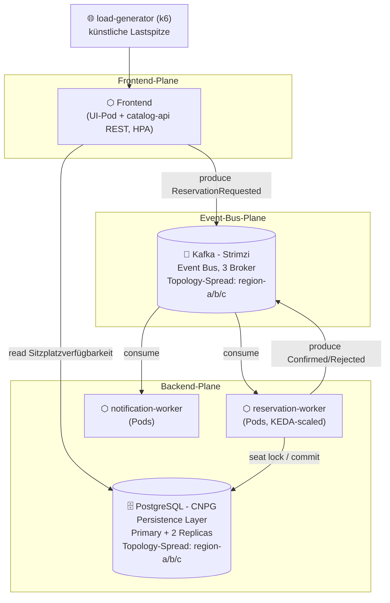

# TicketFlow

Cloud-native Ticketverkaufsplattform für Live-Events. Prüfungsleistung "Cloud Infrastructures and
Cloud Native Applications", DHBW. Dieses Dokument ersetzt den schriftlichen Bericht vollständig.

## ToDo

Pfisterer:
- Application
   - Frontend -> Philipp
      - Buchungsseite, Sitzplatzauswahl, Anzeige Bestätigung, Fehlermeldung, Datenbank Info welche PLätze belegt, Session ID Kundenunterscheidung
   - API + Kafka Producer -> Philipp
   - Kafka Consumer -> Carlos
      - DB Schema aufbauen und über applikation versionieren
      - Event verarbeitung mit Reservierung des sitzplatzes, anschließend event ob successfull oder nicht
   - Message service -> Niklas
- Kafka Cluster -> Carlos
   - Schema Registry
   - Kafka Cluster
   - AKHQ als Oberfläche
- Postgres Cluster -> Niklas


Für alle Applikationen:
- Scheduling und Platzierung der Pods
- Resilienz der deployments
- Requests und Limits checken
- Helm Chart mit Values Schema

Bonus:
- Helm Charts
- Packaging von Helm Charts
- Kafka Strimzi
- Chaos Experiment


Screen Cast:
Alle Zusammen


- Observability mit OpenTelemetry
   - Logging
   - Metriken
   - evtl. Traces
- Autoscaler

Sturm:
Beleuchten Sie die ihnen zugeteilte Laborarbeit auf der Basis der in der Vorlesung
vermittelten theoretischen Grundlagen:
− Welche Vorteile und Nachteile ergeben sich für Ihre Anwendung aus der Realisierung
als Cloud Native? Zeigen Sie dabei auch alternative Realisierungsmöglichkeiten auf,
stellen Sie diese Ihrer Cloud Native Lösung gegenüber und erörtern Sie kritisch.
Unterlegen sie ihrer Argumentation mit konkreten Beispielen.
− Wie gewährleisten Sie die Datensicherheit? Bewerten Sie dabei auch die Relevanz der
DSGVO für Ihre Anwendung.
− Skizzieren und begründen Sie abschließend welche Cloud Native Pattern sich wo in
ihrer Anwendungsarchitektur wiederfinden.

Alea macht einen ersten Wurf
 

> **Status:** Repository-Grundgerüst. Diese README beschreibt die geplante und im Aufbau
> befindliche Architektur; Abschnitte, die noch nicht final implementiert sind, sind mit `TODO`
> markiert. Jeder Ordner enthält eine eigene README mit Detailplanung.

## Problem

Beim Vorverkauf populärer Events (Konzert, Stadion-Match) starten tausende Nutzer innerhalb
weniger Sekunden denselben Kaufversuch für eine kleine, feste Anzahl an Plätzen. Ein klassischer
synchroner CRUD-Ansatz (Request → sofortiger DB-Write) macht die Datenbank zum Flaschenhals:
Nutzer sehen Timeouts statt einer fairen Reihenfolge, und Plätze werden im Zweifel doppelt
vergeben (Overselling). TicketFlow trennt die *Annahme* einer Reservierungsanfrage von deren
*Verarbeitung* über einen Message Bus und skaliert die Verarbeitung anhand der Warteschlangenlänge
nach. Genau dieser Lastpfad – "viele gleichzeitige Reservierungen für ein knappes Kontingent" –
ist der fachliche Grund, warum Queue, Datenbank und Autoscaling hier tatsächlich gebraucht werden,
nicht nur vorgeführt.

## Architektur



**Datenfluss von der VM bis zum Pod:**

1. Terraform/OpenTofu erzeugt gegen den OpenStack-Provider der DHBWCloud vier VMs (1
   Control-Plane, 3 Worker) direkt am vorhandenen, extern routbaren Projektnetz `DHBWV6` – kein
   eigenes Netz, kein Router, keine selbst verwaltete Security Group — siehe
   [`infra/terraform/`](infra/terraform/). Jeder Worker erhält eine virtuell simulierte
   Regions-Metadata (`region-a`/`region-b`/`region-c`), da die DHBWCloud real nur eine
   Region/AZ bereitstellt.
2. Ansible konfiguriert die VMs, installiert k3s (Server auf der Control-Plane, Agents auf den
   Workern), übernimmt die simulierte Region als Kubernetes-Node-Label
   (`topology.ticketflow/region`) und bootstrapt ArgoCD — siehe [`infra/ansible/`](infra/ansible/).
3. ArgoCD übernimmt ab hier per GitOps den Rest: ein einziges `ApplicationSet`
   ([`gitops/applicationset.yaml`](gitops/applicationset.yaml)) erzeugt alle 19 Applications —
   CNPG-Operator, Strimzi-Operator, KEDA, kube-prometheus-stack und die TicketFlow-Charts selbst.
   Alle deployment-spezifischen Werte kommen dabei aus der zentralen
   [`gitops/env/cluster.yaml`](gitops/env/cluster.yaml) — siehe [`gitops/`](gitops/).
4. `catalog-api` nimmt Reservierungsanfragen entgegen und veröffentlicht sie als Event auf Kafka,
   statt synchron in die Datenbank zu schreiben.
5. `reservation-worker` konsumiert diese Events, sperrt den Sitzplatz transaktional in CNPG-Postgres
   und veröffentlicht das Ergebnis (bestätigt/abgelehnt) wieder auf Kafka.
6. `notification-worker` konsumiert das Ergebnis und simuliert eine Bestätigungs-Benachrichtigung.
7. Der `load-generator` erzeugt künstlich die namensgebende Lastspitze; Prometheus/Grafana machen
   Backlog, Fehlerquote und Replica-Anzahl sichtbar, KEDA reagiert auf den Kafka-Consumer-Lag.

Detailskizze und Screenshots des tatsächlichen Deployments folgen in
[`docs/architecture/`](docs/architecture/) (`TODO`, sobald der Cluster steht).

## Betrieb

Das gesamte Deployment wird über **eine** git-getrackte Konfigurationsdatei gesteuert:
[`gitops/env/cluster.yaml`](gitops/env/cluster.yaml). Sie wird von Terraform, Ansible, ArgoCD und
allen Helm-Charts gelesen — Fork-URL, DNS-Zone, ACME-Kontakt, Image-Registry, Image-Tag und die
Umgebung (`dev`/`prod`) stehen dort jeweils genau einmal. Nur echte Geheimnisse liegen daneben, in
zwei gitignorierten Dateien.

### Einmalig je Fork

Diese Schritte lassen sich nicht aus dem Repo heraus automatisieren:

1. **Repo forken** unter dem eigenen GitHub-Account, **privat** (siehe
   [`gitops/README.md`](gitops/README.md) ## Privates Repo).
2. **Python-venv** für Ansible anlegen — muss aus WSL/Linux laufen, nicht aus nativem Windows
   (`ansible-core` scheitert dort mit `WinError 87`):
   ```bash
   python3 -m venv .venv && source .venv/bin/activate
   pip install -r infra/ansible/requirements.txt
   ```
3. **SSH-Keypair für die VMs**: `~/.ssh/ticketflow_dhbwcloud{,.pub}` (Terraform importiert den
   Public Key; Pfade sind über `ssh_public_key_path`/`ssh_private_key_path` änderbar).
4. **DNS-Zone registrieren** auf `self-service.dhbw.cloud` mit RFC2136-Freigabe. Notiert werden
   Zonenname, TSIG-Key-**Name** und TSIG-Secret-**Wert**.
5. **ArgoCD-Deploy-Key erzeugen** und den Public Key im eigenen Fork unter *Settings → Deploy keys*
   als **Read-only** eintragen — ohne ihn kann ArgoCD das private Repo nicht klonen und alle
   Applications bleiben `Unknown`:
   ```bash
   ssh-keygen -t ed25519 -C "argocd-deploy-key@ticketflow" \
     -f infra/ansible/argocd_deploy_key -N ""
   cat infra/ansible/argocd_deploy_key.pub
   ```
6. **Images bauen lassen**: Workflow `build-images` in *Actions* einmal manuell starten
   (`workflow_dispatch`). Ein frischer Fork hat sonst noch keine Images, und alle vier Services
   landen im `ImagePullBackOff`.
7. **Die vier ghcr.io-Packages auf „Public" stellen** (GitHub → Packages → jeweils *Package
   settings*). Der eingebaute `GITHUB_TOKEN` kann das nicht selbst setzen; bis dahin scheitert der
   Pull trotz korrektem Tag.
8. **DHBW-Netz/VPN**: `certificates.dhbw.cloud` (ACME) ist nur von dort erreichbar.

### Konfigurieren

```bash
# 1. Zentrale Konfiguration - die einzige git-getrackte Datei, die angefasst werden muss
$EDITOR gitops/env/cluster.yaml
#    repoURL, dnsZone, acmeEmail, rfc2136.keyName, imageRegistry, namePrefix

# 2. Die eine Repo-URL im git-Generator des ApplicationSet (Henne-Ei, siehe Kommentar dort)
$EDITOR gitops/applicationset.yaml

# 3. Committen UND in den eigenen Fork pushen.
#    ArgoCD liest ausschliesslich den Remote-Stand von targetRevision - ein lokal geaenderter,
#    ungepushter Stand wird nie ausgerollt.
git commit -am "chore: configure deployment" && git push

# 4. Geheimnisse (beide gitignored, je eine .example-Vorlage daneben)
cp infra/terraform/terraform.tfvars.example infra/terraform/terraform.tfvars
#    -> OpenStack-Application-Credentials, Region, Image, Flavors
cp infra/ansible/secrets.yml.example infra/ansible/secrets.yml
#    -> rfc2136_tsig_secret_value (der WERT, nicht der Key-Name)
```

### Ausrollen

```bash
# 1. Infrastruktur auf der DHBWCloud erzeugen (generiert auch inventory/hosts.ini)
cd infra/terraform
terraform init
terraform apply

# 2. VMs konfigurieren, k3s aufbauen, ArgoCD bootstrappen, GitOps-Secrets anlegen.
#    Der letzte Schritt wendet gitops/applicationset.yaml an - alles Weitere rollt ArgoCD aus.
cd ../ansible
ansible-inventory -i inventory/hosts.ini --list
ansible-playbook playbooks/site.yml
#    -> das initiale ArgoCD-Admin-Passwort steht in der Playbook-Ausgabe

# 3. Rollout prüfen (aus dem Repo-Wurzelverzeichnis)
cd ../..
export KUBECONFIG=infra/ansible/kubeconfig
kubectl -n argocd get applicationset ticketflow
kubectl -n argocd get applications          # 19 Stueck, alle Synced/Healthy
kubectl get pods -A -o wide
kubectl get kafka,cluster.postgresql.cnpg.io -A

# 4. Künstlichen Lastpfad auslösen
cd src/load-generator
k6 run flash-sale.js --env EVENT_ID=demo-event --env VUS=500

# 5. Beobachten
kubectl port-forward svc/kube-prometheus-stack-grafana 3000:80 -n monitoring
# -> Dashboard "TicketFlow Overview" öffnen
```

Von `dev` auf `prod` (mehr Replicas, Topology-Spread mit Wirkung, engere PodDisruptionBudgets)
schaltet eine einzige Zeile um — `ticketflow.environment` in `gitops/env/cluster.yaml`. Das
ApplicationSet zieht daraufhin für jeden Chart die passende `values-<env>.yaml`.

Ein frisch erzeugtes Projekt auf der DHBWCloud muss allein mit diesen Schritten zum laufenden
Stack führen.

### Lokale Entwicklung (catalog-api + frontend)

Rein für die Entwicklung von `catalog-api`/`frontend`, kein Teil des obigen Cluster-Pfads:

```bash
docker compose up -d --build
# frontend: http://localhost:8081, catalog-api: http://localhost:8080
docker compose down -v
```

Postgres/Kafka laufen dabei als lokale Stand-ins für CNPG/Strimzi (Seed-Daten aus
`local/postgres/init.sql`). `reservation-worker` läuft im selben Compose-Stack mit (baut sein
eigenes DB-Schema beim Start über versionierte Migrationen auf, siehe
`src/reservation-worker/README.md`) und verarbeitet die Buchung bis `confirmed`/`rejected` durch
— die Kafka-Message (`ReservationRequested`) lässt sich trotzdem direkt prüfen:

```bash
docker exec $(docker compose ps -q kafka) /opt/kafka/bin/kafka-console-consumer.sh \
  --bootstrap-server localhost:29092 --topic reservation-requested --from-beginning
```

## Entscheidungen

Je Pflicht- und Wahlthema: Wahl, Alternative, Begründung.

**P1 – Anwendung und Domäne.** *Wahl:* drei eigene Services (`catalog-api`,
`reservation-worker`, `notification-worker`) plus CNPG-Postgres und Strimzi-Kafka als
zustandsbehaftete Dienste. *Alternative:* ein einzelner Monolith mit synchronem DB-Zugriff.
*Begründung:* Erst die Trennung von Annahme (API) und Verarbeitung (Worker) über eine Queue macht
den Lastpfad des Flash-Sales beherrschbar und erlaubt, genau den Engpass-Service unabhängig zu
skalieren. `catalog-api` selbst ist in Go + `chi` umgesetzt (schreibt bewusst nie synchron in
Postgres, nur lesend + Kafka-Producer, siehe `src/catalog-api/README.md`), damit dieselbe
Toolchain wie im geplanten `reservation-worker` zum Einsatz kommt und das Image im Flash-Sale-Pfad
klein/schnell startend bleibt. *Alternative:* Python + FastAPI (schnelleres Prototyping, aber
größeres Image und eine zweite Toolchain neben Go).

**P2 – Infrastruktur als Code.** *Wahl:* Terraform/OpenTofu gegen den OpenStack-Provider für
VMs/Netz, Ansible für OS-Konfiguration und k3s-Bootstrap — ein `terraform apply` gefolgt von einem
`ansible-playbook site.yml` bringt den kompletten Stack hoch. *Alternative:* manuell im
DHBWCloud-Portal angelegte VMs, oder ein anderes IaC-Werkzeug (z. B. Pulumi) statt der
vorgeschlagenen Kombination. *Begründung:* Ein Portal-Klick wäre schneller, ließe sich aber nicht
reproduzieren und zählt laut Aufgabenstellung explizit nicht als Nachweis ("kein Klick im
Portal"); Managed Kubernetes ist auf der DHBWCloud ohnehin ausgeschlossen. Terraform+Ansible trennt
zusätzlich sauber "Ressourcen existieren" (Terraform, siehe
[`infra/terraform/`](infra/terraform/)) von "Ressourcen sind konfiguriert" (Ansible, siehe
[`infra/ansible/`](infra/ansible/)) — ein einzelnes Werkzeug für beides würde diese Trennung
verwischen und macht schwerer nachvollziehbar, welcher Schritt für einen fehlgeschlagenen Bootstrap
verantwortlich ist.

**P3 – Deployment und Konfiguration.** *Wahl:* Helm-Werte legen Requests/Limits je Service fest
(z. B. `notification-worker`: 25m/100m CPU, 32Mi/64Mi Memory — bewusst klein, weil der Dienst nur
Kafka-Konsum und kurze Log-/SMTP-Aufrufe macht, keine CPU-intensive Verarbeitung wie
`reservation-worker`; siehe [`charts/notification-worker/values.yaml`](charts/notification-worker/values.yaml)),
Images werden mit dem Git-SHA statt `:latest` getaggt, DB-Zugangsdaten/Kafka-Bootstrap-Server
kommen aus ConfigMap/Secret. *Alternative:* Werte im Image hart kodieren oder `:latest`
verwenden. *Begründung:* `:latest` macht Rollbacks unmöglich, weil unklar bleibt, welches Image zu
einem Zeitpunkt tatsächlich lief; Secrets im Image wären sowohl in der Registry einsehbar als auch
nicht pro Umgebung (dev/prod, siehe W1) austauschbar, ohne das Image neu zu bauen.

**P4 – Scheduling und Platzierung.** *Wahl:* Jeder Worker trägt ein Node-Label
`topology.ticketflow/region` (`region-a`/`region-b`/`region-c`, von Terraform als Metadata
vergeben und von Ansible in ein Kubernetes-Label übersetzt – die DHBWCloud stellt real nur eine
Region/AZ bereit, die Verteilung wird für diese Entscheidung bewusst simuliert). CNPG-Postgres
(Primary+2 Replicas) und die Kafka-Broker (Strimzi, 3 Broker) erhalten je eine
`topologySpreadConstraint`/`podAntiAffinity` auf diesem Label, sodass ihre Replicas nie auf
demselben simulierten Standort landen. Alle zustandslosen App-Pods (`catalog-api`, `frontend`,
`reservation-worker`, AKHQ, Apicurio) tragen dieselbe weiche Praferenz (`whenUnsatisfiable:
ScheduleAnyway` bzw. eine `preferred`-`podAntiAffinity` dort, wo der jeweilige Helm-Chart kein
natives `topologySpreadConstraints`-Feld anbietet, z. B. AKHQ) — wirkungslos, solange ein Dienst
nur mit einer Replica läuft, greift aber sofort, sobald KEDA `reservation-worker` hochskaliert.
*Alternative:* freie Platzierung durch den
Standard-Scheduler, oder ein einzelner dedizierter "Storage-Node" für beide Dienste.
*Begründung:* Freie Platzierung könnte alle Replicas eines Dienstes zufällig auf denselben Node
verteilen — der Ausfall genau dieses einen Nodes würde Ticket-Reservierungen und deren Event-Log
komplett verschwinden lassen. Ein einzelner Storage-Node wäre selbst wieder ein Single Point of
Failure und hätte die Platzierungsfrage nur verschoben statt aus der Domäne (Ausfallsicherheit
beim Ticketverkauf, nicht aus der Vorlesung) heraus beantwortet.

**P5 – Resilienz und Persistenz.** *Wahl:* Liveness/Readiness-Probes auf allen drei Services, CNPG
verwaltet PVCs für Primary+2 Replicas, Strimzi-Kafka-Broker laufen als StatefulSet mit PVC,
PodDisruptionBudgets sichern Rolling Updates ab (für `notification-worker` bereits umgesetzt:
`replicaCount: 3`, `minAvailable: 2`, siehe
[`charts/notification-worker/templates/poddisruptionbudget.yaml`](charts/notification-worker/templates/poddisruptionbudget.yaml)).
*Alternative:* `emptyDir` statt PVC, oder ein Single-Instance-Postgres ohne Replikation.
*Begründung:* `emptyDir` und ein Single-Instance-Postgres wären einfacher aufzusetzen, aber jeder
Pod-Neustart bzw. Node-Ausfall würde dann Reservierungsdaten unwiederbringlich löschen statt sie
nur kurz unerreichbar zu machen. Ticket-Reservierungen sind Geschäftsdaten; ein Pod-Verlust darf
keine Bestellung verlieren, ein Rolling Update der API darf keine Downtime verursachen.

**P6 – Skalierbarkeit.** *Wahl:* KEDA (`charts/keda`, Operator; `ScaledObject`/
`TriggerAuthentication` in `charts/reservation-worker/templates/keda-scaledobject.yaml`) skaliert
`reservation-worker` auf Basis des Kafka-Consumer-Group-Lags von `reservation-requested`.
*Alternative:* HPA auf CPU-Auslastung. *Begründung:* Die eigentliche fachliche Engpassgröße ist
"wie viele Reservierungen warten auf Verarbeitung", nicht CPU-Last — CPU kann bei I/O-gebundener
Arbeit (Warten auf DB-Commit, Kafka-Fetch) trügerisch niedrig bleiben, obwohl die Warteschlange
wächst und Kunden auf ihre Bestätigung warten. Der Trade-off: eine Lag-basierte Metrik braucht
einen zusätzlichen Scaler/Adapter (KEDA) statt der im Cluster bereits eingebauten HPA-CPU-Metrik —
der Mehraufwand lohnt sich hier, weil CPU-Skalierung im Lasttest schlicht am falschen Signal
skalieren würde.

| Wert | dev (aktuell synct) | prod | Begründung |
|---|---|---|---|
| `keda.maxReplicaCount` | 3 | 8 | = Partitionszahl von `reservation-requested` je Kafka-Profil (`charts/kafka-cluster` `values-dev.yaml`/`values-prod.yaml`) — mehr Consumer als Partitionen innerhalb einer Consumer-Group wären untätig |
| `keda.lagThreshold` | 10 | 10 | passt zum 30-Sitzplatz-Demo-Event (`local/postgres/init.sql`): ein kompletter Sellout-Burst treibt die Skalierung bis auf `maxReplicaCount` |
| `keda.pollingInterval`/`.cooldownPeriod` | 15s/60s | 15s/60s | kürzer als KEDAs Default (30s/300s), damit ein Screencast Hoch- **und** Rückskalierung in vertretbarer Zeit zeigt |

`reservation-worker`s `replicaCount` im Chart ist seit KEDA nur noch der Deployment-Startwert;
Das Element `reservation-worker` im ApplicationSet ignoriert `spec.replicas` explizit
(`ignoreDifferences`),
sonst würde ArgoCDs `selfHeal` jede KEDA-Skalierung sofort wieder zurücksetzen — Standardmuster
für ArgoCD zusammen mit einem HPA/KEDA-verwalteten Deployment.

**P7 – Observability.** *Wahl:* Jeder Service exponiert `/metrics` (Prometheus-Client). Wo ein
Service von anderen Pods über eine `Service`-Ressource erreichbar sein muss, wird per
`ServiceMonitor` gescraped (`catalog-api`, `reservation-worker`, geplant); wo es — wie bei
`notification-worker` — keinen anderen Konsumenten der HTTP-Endpunkte gibt (reiner
Kafka-Consumer, keine eingehenden Requests), entfällt die `Service`-Ressource zugunsten eines
direkt auf die Pod-Labels zielenden `PodMonitor` (bereits umgesetzt, siehe
[`charts/notification-worker/templates/podmonitor.yaml`](charts/notification-worker/templates/podmonitor.yaml)).
CNPG und Strimzi bringen eigene Metriken mit, ein Grafana-Dashboard liegt als Code
(`observability/dashboards/`) vor, eine Alert-Regel feuert auf "Reservation-Backlog über
Schwellwert für 5 Minuten". *Alternative:* Ad-hoc-Logging ohne Metriken, oder überall
`ServiceMonitor` samt unbenutzter `Service`-Ressource statt `PodMonitor`. *Begründung:* Ohne
Metriken lässt sich P6 nicht demonstrieren — KEDA braucht eine abfragbare Zeitreihe, kein
Log-Grepping. Eine unbenutzte `Service`-Ressource nur für den Scraper wäre reine Zeremonie; die
Alert-Regel macht zusätzlich sichtbar, ab wann die Lastspitze geschäftlich relevant wird
(Kunden warten spürbar), nicht nur technisch (Lag-Zahl steigt).

**W1 – Packaging (Helm).** *Wahl:* ein Chart je Komponente, alle nach demselben verbindlichen
Muster (siehe [`charts/README.md`](charts/README.md) ## Muster für Applikations-Charts) mit
`values-dev.yaml`, `values-prod.yaml` und `values.schema.json`; übergreifende Werte
(Image-Registry/-Tag, DNS-Zone, Umgebung) stehen einmalig in
[`gitops/env/cluster.yaml`](gitops/env/cluster.yaml) und werden von ArgoCD per Multi-Source
`$values` in jeden Chart gereicht. *Alternative:* Kustomize mit Base+Overlays. *Begründung:*
Kustomize kennt kein Werte-Schema — ein vergessener oder falsch typisierter Wert (etwa eine
String- statt Int-Replica-Zahl, oder ein leerer Image-Tag) fiele erst zur Laufzeit im Cluster auf.
Genau das ist hier schon einmal passiert: `notification-worker` lag mit leerem `image.tag` im
Repo und war ohne `--set` gar nicht deploybar. Mit Helm+`values.schema.json` schlägt
`helm lint`/`helm template` vorher fehl, bevor eine falsch konfigurierte CNPG-`Cluster`- oder
Strimzi-`Kafka`-Ressource überhaupt angewendet wird — bei zustandsbehafteten Custom Resources ist
das der relevantere Fehlerzeitpunkt. Für den Flash-Sale-Pfad zählt konkret, dass das Umschalten
von `dev` auf `prod` (mehr `reservation-worker`-Replicas, echter Topology-Spread, engere
PodDisruptionBudgets) eine einzige Zeile ist und nicht ein Dutzend über Charts verstreute Werte.

**W2 – GitOps.** *Wahl:* ArgoCD mit einem `ApplicationSet` (Matrix aus git-files- und
list-Generator), Auto-Sync und Self-Heal.
*Alternative:* reines `kubectl apply`/eine CI-Pipeline ohne Cluster-seitigen Agenten.
*Begründung:* Ansible bootstrappt bewusst nur so viel, dass ArgoCD läuft; alles danach (Operatoren,
Kafka, Postgres, App) kommt aus Git. Der Trade-off: eine reine CI-Pipeline hätte keinen laufenden
Agenten im Cluster, der Drift erkennt — eine manuell (z. B. während eines Incidents) geänderte
Replica-Zahl bliebe bestehen, bis zufällig die nächste Pipeline läuft, statt automatisch per
Self-Heal zurückgedreht zu werden. Das ApplicationSet statt einzelner `Application`-Dateien
(App-of-Apps) ist dabei bewusst gewählt: vorher stand die Repo-URL 20-mal im Repo, und ein Fork,
der eine Stelle übersah, bekam ein Deployment, das still gegen das Original-Repo lief. Für ein Laborsetup mit mehreren Bearbeitern, die versehentlich
`kubectl edit` statt eines Commits benutzen könnten, ist genau das der relevante Fall.

## Grenzen

- Die DHBWCloud stellt nur eine begrenzte Anzahl VMs/Ressourcen bereit; CNPG- und Kafka-Replikation
  sind daher klein dimensioniert (nicht produktionsreif für echte Lastspitzen mit Millionen Nutzern).
- Zahlungsabwicklung ist simuliert (kein echtes Payment-Gateway); `notification-worker` kann
  optional per SMTP echte E-Mails versenden, fällt aber standardmäßig (kein SMTP-Relay im
  Demo-Betrieb konfiguriert) auf reine Log-Ausgabe statt echtem E-Mail/SMS-Versand zurück.
- k3s statt eines vollwertigen Kubernetes verkleinert den Kontrollebenen-Fußabdruck, verhält sich
  aber nicht in jedem Detail wie ein Cloud-Provider-Kubernetes.
- Der Lastgenerator bildet einen synthetischen "alle klicken gleichzeitig"-Fall nach; reales
  Nutzerverhalten (Netzwerklatenz-Verteilung, Retry-Verhalten von Browsern) ist nicht modelliert.
- Ein Node-Ausfall der Control-Plane ist nicht automatisch behoben (kein HA-Control-Plane geplant);
  das ist eine bewusste Kosten/Nutzen-Entscheidung für den Laborrahmen.

*(TODO: nach Lasttests unter echten Bedingungen konkretisieren, was tatsächlich beobachtet wurde.)*

## Bonus

> `TODO`: Beide Leistungen sind unten als Plan beschrieben, aber noch **nicht umgesetzt** — dieser
> Abschnitt wird erst final in der Abgabe stehen bleiben, wenn Nachweis im Betrieb existiert
> (Aufgabenstellung: "ein erfüllter Haken allein reicht nicht, es zählt die Tiefe"). Bis dahin dient
> er als Umsetzungsplan; Verweise auf Dateien werden ergänzt, sobald sie existieren.

**B1 – Drittes Wahlthema: W7 Cluster-Härtung.** *Was getan werden soll:* Deny-by-default
Network Policies je Namespace (`kafka`, `cnpg-system`, künftiger `ticketflow`-App-Namespace) plus
explizite Allow-Regeln für die tatsächlich benötigten Pfade — `catalog-api`/`reservation-worker` →
CNPG-Primary auf Port 5432, `catalog-api`/`reservation-worker`/`notification-worker` → Kafka-Broker
auf 9092/9093, Prometheus → `/metrics` auf allen drei Services, ArgoCD → Kubernetes-API-Server.
Drei Charts haben ein solches Netzwerk-Policy-Netz bereits scope-geprüft aktiv (`cert-manager`,
`kube-prometheus-stack`, `tempo`, siehe `charts/README.md` ## Resource-Limits, Security-Context,
NetworkPolicy); CNPG, Strimzi, Longhorn und `external-dns` bringen aber kein eigenes
`networkPolicy`-Feld mit (dort müssten die Policies selbst geschrieben werden) und
`notification-worker`/`loki` haben ihr Toggle bewusst noch aus. Dazu: die bislang rein
gitignoreten `infra/ansible/secrets.yml` (RFC2136-TSIG) und `infra/ansible/argocd_deploy_key`
werden SOPS-verschlüsselt (age-Backend) eingecheckt statt nur lokal zu existieren und
out-of-band verteilt zu werden — Ansible entschlüsselt sie zur Laufzeit über ein
`community.sops`-Lookup-Plugin, ein `.sops.yaml` legt fest, welche Felder verschlüsselt werden.
*Alternative:* Sealed Secrets (Controller-basiert) oder Vault (eigener Dienst) statt SOPS.
*Begründung:* Sealed Secrets bräuchte einen zusätzlichen, selbst zu betreibenden
zustandsbehafteten Controller nur für diesen einen Zweck; Vault wäre für ein Laborsetup mit
überschaubarer Secret-Zahl deutlich überdimensioniert. SOPS verschlüsselt einzelne Dateien ohne
zusätzlichen Cluster-Dienst und passt zum bestehenden Muster
(`secrets.yml.example`/`terraform.tfvars.example`) — die verschlüsselte Datei kann committet
werden, ohne das bisherige `delegate_to: localhost`-Modell von `gitops_secrets` zu ändern.
*Nachweis im Betrieb (geplant):* `kubectl describe networkpolicy -A` zeigt die Deny-by-default-
Policies; ein Pod ohne passendes Label kann nachweislich **nicht** gegen CNPG:5432 oder den
Kafka-Broker verbinden (negative Probe); `git show` zeigt die SOPS-verschlüsselte
`secrets.yml`, `sops -d` (nur mit dem richtigen age-Key) das Klartext-Ergebnis.

**B2 – Neue Technologie: Kafka-Betrieb mit Strimzi über den Beispielumfang der Vorlesung
hinaus.** *Was umgesetzt wurde:* Statt eines einzigen, cluster-weit geteilten Kafka-Credentials
für alle Services bekommt jeder Client über Strimzis **User Operator** eine eigene
`KafkaUser`-Custom-Resource mit SCRAM-SHA-512-Authentifizierung und ein eigenes, engst mögliches
`spec.authorization` (`type: simple`, ACLs) — siehe `charts/kafka-cluster/templates/messaging/
kafka-users.yaml`, generiert aus `values.yaml` `kafka.users`: `catalog-api` darf nur `Write` auf
`reservation-requested`, kein `Read`; `reservation-worker` darf `Read` auf
`reservation-requested` (+ die eigene Consumer-Group) und `Write` auf `reservation-result`;
`notification-worker` darf ausschließlich `Read` auf `reservation-result` (+ eigene
Consumer-Group). Der Kafka-Cluster läuft in einem **eigenen Namespace** (`kafka`), getrennt von
der Anwendung (`ticketflow`) — für die Secrets folgt daraus zweierlei: die `KafkaUser`-CRs von
`catalog-api`/`reservation-worker`/`notification-worker` werden bewusst im **App**-Namespace
angelegt (`spec.entityOperator.userOperator.watchedNamespace`), damit das vom User Operator
erzeugte Secret dort landet, wo die Services es per `secretKeyRef` lesen können; **AKHQ**
(schreibgeschützt konfiguriert) läuft dagegen im Kafka-Namespace und bekommt ein vorgegebenes
Passwort über `spec.authentication.password.valueFrom.secretKeyRef` auf ein selbst angelegtes,
austauschbares Secret. Der Grund ist in beiden Fällen derselbe: Kubernetes erlaubt kein
`secretKeyRef` über Namespace-Grenzen. *Alternative:* ein einziges, geteiltes Client-Secret für alle
Producer/Consumer (der in der Vorlesung/GridFlex gezeigte Umfang), oder Kafka-ACLs händisch per
`kafka-acls.sh` statt deklarativ über `KafkaUser`. *Begründung:* Ein geteiltes Secret ist
funktional ausreichend, um Nachrichten zu produzieren/konsumieren, macht aber jeden Service
implizit zu einem Producer/Consumer auf *jedem* Topic — ein Bug in `notification-worker` könnte
dann unbemerkt in `reservation-result` schreiben und stille Dateninkonsistenz erzeugen, statt
sofort mit einer `TopicAuthorizationException` abgelehnt zu werden. Händische
`kafka-acls.sh`-Aufrufe wären nicht GitOps-versioniert und müssten bei jedem Cluster-Rebuild
manuell wiederholt werden; `KafkaUser` als Custom Resource kommt wie alles andere aus Git und wird
von ArgoCD mitverwaltet (siehe W2). *Tragend, nicht dekorativ:* Die ACLs ändern das tatsächliche
Fehlerverhalten bei einem Bug (harter Autorisierungsfehler statt stiller Fehlschreibung) und sind
damit Teil des Resilienz-/Datensicherheits-Arguments aus ## Grenzen, nicht nur eine zusätzliche
Konfigurationsdatei. *Nachweis im Betrieb (noch nicht live geprüft, kein Cluster verfügbar):*
`kubectl get kafkauser -n ticketflow` zeigt die vier Nutzer; ein absichtlich falsch konfigurierter
Test-Producer (z. B. ein `kubectl run`-Pod mit `notification-worker`s Credentials, der versucht
auf `reservation-requested` zu schreiben) wird von Kafka mit einer Autorisierungs-Exception
abgelehnt — eine Screencast-taugliche Negativprobe; AKHQ zeigt die Consumer-Groups mit wachsendem/
fallendem Lag live während der P6-Lastdemo.
