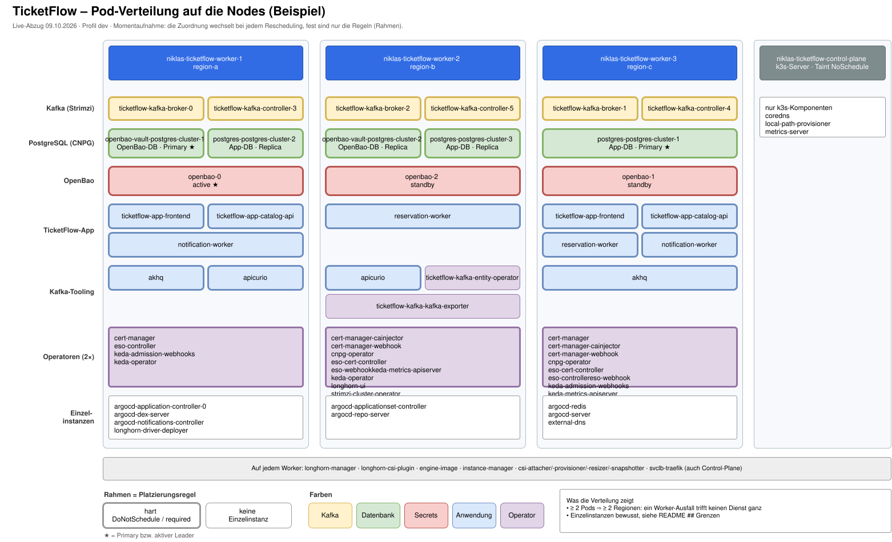

# TicketFlow

TicketFlow ist eine cloud-native Ticketverkaufsplattform für Live-Events.


## Problemstellung

Beim Vorverkauf populärer Events (z.B. Konzert, Fußballspiel) starten tausende Nutzer innerhalb
weniger Sekunden denselben Kaufversuch für eine kleine, feste Anzahl an Plätzen. Ein klassischer
synchroner CRUD-Ansatz (Request → sofortiger DB-Write) macht die Datenbank zum Flaschenhals:
Nutzer sehen Timeouts statt einer fairen Reihenfolge und Plätze werden im Zweifel doppelt
vergeben. TicketFlow trennt die *Annahme* einer Reservierungsanfrage von deren
*Verarbeitung* über einen Message Bus und skaliert die Verarbeitung anhand der Warteschlangenlänge
nach. Genau dieser Lastpfad ist der fachliche Grund, warum Queue, Datenbank und Autoscaling hier tatsächlich gebraucht werden.

## Architektur



Fachlicher Lastpfad (durchgezogene Pfeile): `catalog-api` nimmt die Reservierung an und
veröffentlicht sie nur (①), `reservation-worker` sperrt den Platz in Postgres (②) und meldet das
Ergebnis zurück auf Kafka (③), der `notification-worker` als zweite, unabhängige Consumer-Group
liest. 
Gestrichelt: Steuerung und Plattform (GitOps, Secrets, Autoscaling, DNS/TLS). Die Datei ist
ein draw.io-SVG mit eingebettetem Diagramm — direkt in [draw.io](https://app.diagrams.net) oder
der VS-Code-Erweiterung „Draw.io Integration" öffnen und bearbeiten, GitHub rendert sie als Bild.

**Datenfluss von der VM bis zum Pod:**

1. Terraform/OpenTofu erzeugt gegen den OpenStack-Provider der DHBWCloud vier VMs (1
   Control-Plane, 3 Worker) direkt am vorhandenen, extern routbaren Projektnetz `DHBWV6` – kein
   eigenes Netz, kein Router, keine selbst verwaltete Security Group, siehe
   [`infra/terraform/`](infra/terraform/). Jeder Worker erhält eine virtuell simulierte
   Regions-Metadata (`region-a`/`region-b`/`region-c`), da die DHBWCloud real nur eine
   Region/AZ bereitstellt.

2. Ansible konfiguriert die VMs, installiert k3s (Server auf der Control-Plane, Agents auf den
   Workern), übernimmt die simulierte Region als Kubernetes-Node-Label
   (`topology.ticketflow/region`) und bootstrapt ArgoCD, siehe [`infra/ansible/`](infra/ansible/).

3. ArgoCD übernimmt ab hier per GitOps den Rest: zwei `ApplicationSets`
   ([`gitops/applicationsets/`](gitops/applicationsets/)) erzeugen gestuft zusammen alle 21
   Applications. Zuerst die Plattform mit Cluster-Addons (Longhorn, cert-manager,
   external-dns), den Operatoren (CNPG, Strimzi, KEDA, External Secrets) und der zentralen
   Secret-Vault OpenBao. Erst wenn deren Pods alle Health-Checks bestehen, erfolgt die Generierung der Anwendung. Diese besteht aus
   Datenhaltung, Kafka, die projektweiten NetworkPolicies (siehe `## Bonus`) und die
   TicketFlow-Charts selbst. Alle deployment-spezifischen Werte kommen dabei
   aus der zentralen [`gitops/env/cluster.yaml`](gitops/env/cluster.yaml), siehe
   [`gitops/`](gitops/).

4. `catalog-api` nimmt Reservierungsanfragen entgegen und veröffentlicht sie als Event auf Kafka,
   statt synchron in die Datenbank zu schreiben.

5. `reservation-worker` konsumiert diese Events, sperrt den Sitzplatz transaktional in CNPG-Postgres
   und veröffentlicht das Ergebnis (bestätigt/abgelehnt) wieder auf Kafka.

6. `notification-worker` konsumiert das Ergebnis und simuliert eine Bestätigungs-Benachrichtigung.

7. Der `load-generator` erzeugt künstlich die namensgebende Lastspitze. KEDA reagiert auf den
   dadurch wachsenden Kafka-Consumer-Lag und skaliert den `reservation-worker` hoch. Dies ist sichtbar über
   `kubectl get pods`/`scaledobject` und den Consumer-Lag in AKHQ (siehe `## Betrieb`/`## Bonus`;
   kein Grafana-Dashboard, siehe `## Grenzen`).

**Pod-Verteilung im laufenden Cluster – ein Beispiel** (realer Abzug vom 09.10.2026, dev-Profil,
aus `kubectl get pods -A -o wide`). Welcher Pod auf welchem Node landet, ändert sich bei jedem
Neustart oder Rescheduling. Fest sind nur die Platzierungsregeln, die das Bild sichtbar macht:



Kafka-Broker/-Controller und OpenBao liegen erzwungen je einmal pro simulierter Region,
die drei App-Postgres-Pods (Primary + zwei Replicas) ebenso, und jeder weitere Dienst läuft mit
mindestens zwei Pods in zwei Regionen (siehe `## Entscheidungen`, P4). Auf der getainteten
Control-Plane laufen nur k3s' eigene Komponenten. Weitere Screenshots folgen in
[`docs/architecture/`](docs/architecture/).

## Betrieb

Das gesamte Deployment wird über **eine** git-getrackte Konfigurationsdatei gesteuert:
[`gitops/env/cluster.yaml`](gitops/env/cluster.yaml). Sie wird von Terraform, Ansible, ArgoCD und
allen Helm-Charts gelesen. Fork-URL, DNS-Zone, ACME-Kontakt, Image-Registry, Image-Tag und die
Umgebung (`dev`/`prod`) stehen dort jeweils genau einmal. Nur echte Geheimnisse liegen daneben, in
zwei gitignorierten Dateien.

### Einmalig je Fork

Diese Schritte lassen sich nicht aus dem Repo heraus automatisieren:

1. **Repo forken** unter dem eigenen GitHub-Account, **privat** (siehe
   [`gitops/README.md`](gitops/README.md) ## Privates Repo).

2. **Python-venv** für Ansible anlegen (muss aus WSL/Linux laufen, nicht aus nativem Windows)
   (`ansible-core` scheitert dort mit `WinError 87`):
   ```bash
   python3 -m venv .venv && source .venv/bin/activate
   pip install -r infra/ansible/requirements.txt
   ```
3. **SSH-Keypair für die VMs**: `~/.ssh/ticketflow_dhbwcloud{,.pub}` (Terraform importiert den
   Public Key; Pfade sind über `ssh_public_key_path`/`ssh_private_key_path` änderbar).

4. **DNS-Zone registrieren** auf `self-service.dhbw.cloud` mit RFC2136-Freigabe. Notiert werden
   Zonenname, TSIG-Key-**Name** und TSIG-Secret-**Wert**.

5. **ArgoCD-Deploy-Key erzeugen** und den Public Key im eigenen Fork unter *Settings → Deploy keys*
   als **Read-only** eintragen. Ohne ihn kann ArgoCD das private Repo nicht klonen und alle
   Applications bleiben `Unknown`:
   ```bash
   ssh-keygen -t ed25519 -C "argocd-deploy-key@ticketflow" \
     -f infra/ansible/argocd_deploy_key -N ""
   cat infra/ansible/argocd_deploy_key.pub
   ```
6. **Images bauen lassen**: Workflow `build-images` in *Actions* einmal manuell starten
   (`workflow_dispatch`). Ein frischer Fork hat sonst noch keine Images, und alle vier Services
   landen im `ImagePullBackOff`.

7. **Die vier ghcr.io-Packages auf „Public" stellen** (GitHub → Packages → jeweils *Package
   settings*). Der eingebaute `GITHUB_TOKEN` kann dies nicht selbst setzen. Bis dahin scheitert der
   Pull trotz korrektem Tag.

8. **DHBW-Netz/VPN**: `certificates.dhbw.cloud` (ACME) ist nur von dort erreichbar.

### Konfigurieren

```bash
# 1. Zentrale Konfiguration - die einzige git-getrackte Datei, die angepasst werden muss
$EDITOR gitops/env/cluster.yaml
#    repoURL, dnsZone, acmeEmail, rfc2136.keyName, imageRegistry, namePrefix

# 2. Die Repo-URL in den git-Generatoren der beiden ApplicationSets (Henne-Ei, siehe Kommentar dort)
$EDITOR gitops/applicationsets/platform.yaml gitops/applicationsets/apps.yaml

# 3. Committen UND in den eigenen Fork pushen.
#    ArgoCD liest ausschliesslich den Remote-Stand von targetRevision - ein lokal geäenderter,
#    ungepushter Stand wird nie ausgerollt.
git commit -am "chore: configure deployment" && git push

# 4. Geheimnisse (beide gitignored, je eine .example-Vorlage daneben)
cp infra/terraform/terraform.tfvars.example infra/terraform/terraform.tfvars
#    -> OpenStack-Application-Credentials, Region, Image, Flavors
cp infra/ansible/secrets.yml.example infra/ansible/secrets.yml
#    -> rfc2136_tsig_secret_value (der WERT, nicht der Key-Name)
```

### Ausrollen

```bash
# 1. Infrastruktur auf der DHBWCloud erzeugen (generiert auch inventory/hosts.ini)
cd infra/terraform
terraform init
terraform apply

# 2. VMs konfigurieren, k3s aufbauen, ArgoCD bootstrappen, GitOps-Secrets anlegen.
#    Der letzte Schritt wendet gitops/applicationsets/ gestuft an: erst die Plattform, dann
#    sobald alle Plattform-Applications Synced/Healthy sind, die Anwendung. Das Playbook endet
#    erst, wenn alles grün ist (oder bricht nach 30 min je Stufe mit den roten Apps ab).
cd ../ansible
ansible-inventory -i inventory/hosts.ini --list
ansible-playbook playbooks/site.yml
#    -> das initiale ArgoCD-Admin-Passwort steht in der Playbook-Ausgabe

# 3. Rollout prüfen (aus dem Repo-Wurzelverzeichnis)
cd ../..
export KUBECONFIG=infra/ansible/kubeconfig
kubectl -n argocd get applicationset        # ticketflow-platform, ticketflow-apps
kubectl -n argocd get applications -L ticketflow.io/stage   # 21 Stück, alle Synced/Healthy
kubectl get pods -A -o wide
kubectl get kafka,cluster.postgresql.cnpg.io -A

# 4. Künstlichen Lastpfad auslösen (Docker-Container, kein lokales k6 noetig)
cd src/load-generator
./run.sh                                   # Default: https://ticketflow.<dnsZone>, EVENT_ID=all, 1000 VUs, 3 Min.
# alternativ mit lokal installiertem k6 und expliziten Parametern:
k6 run flash-sale.js --env API_URL=https://ticketflow.<dns-zone> --env EVENT_ID=demo-konzert --env VUS=500 --env DURATION=3m

# 5. Beobachten (kein Observability-Stack im Cluster, siehe ## Grenzen)
kubectl get pods -n ticketflow -l app.kubernetes.io/name=reservation-worker -w   # Replica-Zahl waechst/sinkt mit KEDA
kubectl get scaledobject -n ticketflow
# Kafka-Consumer-Lag live: https://akhq.<dnsZone> (dnsZone aus gitops/env/cluster.yaml)
```

Von `dev` auf `prod` (mehr Replicas über alle drei Regionen, engere PodDisruptionBudgets)
schaltet eine einzige Zeile um und zwar `ticketflow.environment` in `gitops/env/cluster.yaml`. Das
ApplicationSet zieht daraufhin für jeden Chart die passende `values-<env>.yaml`.

Ein frisch erzeugtes Projekt auf der DHBWCloud muss allein mit diesen Schritten zum laufenden
Stack führen.

## Entscheidungen

**P1 – Anwendung und Domäne.** 
*Wahl:* drei eigene Services (`catalog-api`,
`reservation-worker`, `notification-worker`) plus CNPG-Postgres und Strimzi-Kafka als
zustandsbehaftete Dienste. 

*Alternative:* ein einzelner Monolith mit synchronem DB-Zugriff.

*Begründung:* Erst die Trennung von Annahme (API) und Verarbeitung (Worker) über eine Queue macht
den Lastpfad des Flash-Sales beherrschbar und erlaubt, genau den Engpass-Service unabhängig zu
skalieren. `catalog-api` selbst ist in Go + `chi` umgesetzt (schreibt bewusst nie synchron in
Postgres, nur lesend + Kafka-Producer, siehe `src/catalog-api/README.md`), damit dieselbe
Toolchain wie im `reservation-worker` zum Einsatz kommt und das Image im Flash-Sale-Pfad
klein/schnell startend bleibt. Eine weitere Alternative wäre Python + FastAPI (schnelleres Prototyping, aber
größeres Image und eine zweite Toolchain neben Go).

*Nachweis im Betrieb:* `kubectl -n ticketflow get deploy,cluster` zeigt die eigenen Services
neben dem CNPG-Cluster, `kubectl -n kafka get kafka,kafkanodepool` das Strimzi-Kafka. Eine Reservierung über das Frontend
(oder `POST /events/{id}/reservations`) antwortet sofort mit `202` und `status: "pending"`.
Wenige Augenblicke später liefert `GET /reservations/{id}` `confirmed` bzw. `rejected`, ohne dass
die API je in Postgres geschrieben hat. In AKHQ hängen am Topic `reservation-requested` die
Consumer-Group `reservation-worker` und am Topic `reservation-result` die Consumer-Group
`notification-worker`. Ein Ereignis durchläuft also drei unabhängige Dienste über Kafka.

**P1 – Gemeinsame Datenbank für `catalog-api` und `reservation-worker`.** 

*Wahl:* Beide Services nutzen dieselbe CNPG-Datenbank (`ticketflow`) mit demselben, von CNPG generierten
App-User. Die Rollen sind fachlich getrennt: `catalog-api` liest nur (`events`, `seats`,
`reservations` für die Status-Abfrage) und zwar über den Read-Only-Service
`<db>-postgres-cluster-ro`, also von der Replica. `reservation-worker` schreibt als Einziger
(`seats.status`, `reservations`) über `<db>-postgres-cluster-rw` auf den Primary und legt als
Einziger Schema und Stammdaten an (versionierte Migrationen). `notification-worker`
hat keinen Datenbankzugriff. 

*Alternative:* „Database per Service“, also eine eigene Datenbank je
Service: Die API hält eine Lese-Kopie der Sitzplatz-Verfügbarkeit, die sie aus den
`reservation-result`-Events aufbaut (CQRS/Read-Model). 

*Begründung:* Das knappe Gut im Flash-Sale ist der einzelne Sitzplatz, und dessen Zustand darf es nur einmal geben. Der Worker sperrt ihn
atomar per `UPDATE seats … WHERE status = 'free'` und die API zeigt denselben Datensatz an,
nur um die Streaming-Replikation versetzt (typisch Millisekunden). Mit getrennten Datenbanken hinge
die Sitzplatzanzeige dagegen am Consumer-Lag einer Projektion. Gerade in der Lastspitze, wenn der Consumer-Lag hoch ist (genau dann skaliert KEDA), sähen Käufer längst
vergebene Plätze als frei und würden massenhaft in `409`/`Rejected` laufen. Außerdem bräuchte es
einen zweiten CNPG-Cluster samt Replikation und Backup sowie einen Projektionsdienst. Das ist für
drei Tabellen unverhältnismäßig.

*Vorteile:*
- eine Quelle der Wahrheit für den Sitzplatzstatus, keine Synchronisationslücke zwischen Anzeige
  und Buchung;
- die API kann den Endstatus einer Reservierung direkt aus `reservations` lesen;
- nur ein zustandsbehafteter Datenbankdienst muss betrieben, repliziert (Primary + zwei Replicas in drei
  Regionen, P4/P5) und gesichert werden;
- die Replica, die für P5 ohnehin läuft, trägt die Leselast: Die Abfragen der Seat-Map aus dem
  Frontend konkurrieren in der Lastspitze nicht mit den Buchungen des Workers um den Primary.

*Nachteile:*
- **Schema-Kopplung:** Das Schema gehört allein dem `reservation-worker`
  (`src/reservation-worker/internal/migrate/sql/`), aber die SQL-Abfragen von `catalog-api` hängen
  an denselben Tabellen und Spalten. Eine Schemaänderung muss deshalb rückwärtskompatibel
  ausgerollt werden (erst erweitern, dann beide Services umstellen, dann aufräumen). Unabhängige
  Deployments gelten damit nur, solange das Schema stabil bleibt. Außerdem gibt es auf einem
  frischen Cluster die Tabellen erst, wenn der Worker einmal gelaufen ist.
- **Gemeinsamer Fehlerbereich:** Beide hängen am selben CNPG-Cluster. Schreibend bleibt der eine
  Primary die Skalierungsgrenze des Workers, nicht die Pod-Zahl (siehe B2, `maxReplicaCount`).
  Lesend hängt `catalog-api` an den Replicas. Deshalb läuft der Cluster mit `instances: 3`
  (Primary + zwei Replicas, je eine pro Region): Fällt eine Replica aus oder wird sie beim Failover
  zum Primary befördert, bedient die andere `-ro` weiter. Mit nur einer Replica hätte `-ro` in
  diesem Moment keine Endpoints, und weil `/readyz` die Datenbank prüft, wäre `catalog-api`
  komplett nicht bereit, einschließlich der Annahme von Reservierungen. Der Preis ist ein dritter
  Postgres-Pod mit 2Gi Memory-Request.
- **Replikationsverzug:** Die Replica läuft asynchron hinterher. Ein gerade gebuchter Platz kann
  für Millisekunden noch als frei erscheinen. Der Worker entscheidet aber auf dem Primary, so dass
  höchstens ein zusätzliches `Rejected` entsteht, nie eine Doppelbuchung.
- **Kein Least-Privilege über DB-Rechte:** Beide nutzen denselben DB-User. Dass `catalog-api` nicht
  schreibt, erzwingt nur die Replica, weil sie Schreibzugriffe technisch ablehnt, und kein
  Rechte-Konzept.

*Bezug zur Microservice-Architektur:* Das Muster „Database per Service“ fordert, dass jeder
Service seine Daten exklusiv besitzt und andere nur über seine API oder Events darauf zugreifen.
Diese Regel brechen wir hier bewusst an einer Stelle: Es handelt sich um ein *Shared-Database*-
Muster zwischen zwei Services desselben Bounded Context „Reservierung“. Die Entkopplung, auf die es
im Lastpfad ankommt, bleibt erhalten, denn die API schreibt nie synchron und die Annahme läuft
über Kafka. Damit lassen sich API und Worker unabhängig skalieren und ausfallen. Ist der Worker
weg, nimmt die API weiter an und Kafka puffert. Gekoppelt sind die beiden Services nur über das
gemeinsame Schema und das Schema hat genau einen Besitzer (den Worker als einzigen Schreiber).
Lesepfad (Replica) und Schreibpfad (Primary) sind bereits physisch getrennt, eine abgeschwächte
Form von CQRS innerhalb einer Datenbank. `notification-worker` hält sich dagegen vollständig an das
Microservice-Prinzip und kennt nur Events. Die nächsten Schritte wären ein eigener
Nur-Lese-DB-User für `catalog-api` und erst danach eine eigene Datenbank mit eventbasiertem
Read-Model.

**P2 – Infrastruktur als Code.** 
*Wahl:* Terraform/OpenTofu gegen den OpenStack-Provider für
VMs/Netz, Ansible für OS-Konfiguration und k3s-Bootstrap. Ein `terraform apply` gefolgt von einem
`ansible-playbook site.yml` bringt den kompletten Stack hoch. 

*Alternative:* manuell im
DHBWCloud-Portal angelegte VMs, oder ein anderes IaC-Werkzeug (z. B. Pulumi) statt der
vorgeschlagenen Kombination. 

*Begründung:* Ein Portal-Klick wäre schneller, ließe sich aber nicht
reproduzieren und zählt laut Aufgabenstellung explizit nicht als Nachweis ("kein Klick im
Portal"). Managed Kubernetes ist auf der DHBWCloud ohnehin ausgeschlossen. Terraform + Ansible trennt
zusätzlich sauber "Ressourcen existieren" (Terraform, siehe
[`infra/terraform/`](infra/terraform/)) von "Ressourcen sind konfiguriert" (Ansible, siehe
[`infra/ansible/`](infra/ansible/)). Ein einzelnes Werkzeug für beides würde diese Trennung
verwischen und macht schwerer nachvollziehbar, welcher Schritt für einen fehlgeschlagenen Bootstrap
verantwortlich ist.

**P3 – Deployment und Konfiguration.** 
*Wahl:* Helm-Werte legen Requests/Limits je Service fest
(z. B. `notification-worker`: 25m/100m CPU, 32Mi/64Mi Memory (bewusst klein, weil der Dienst nur
Kafka-Konsum und kurze Log-/SMTP-Aufrufe macht, keine CPU-intensive Verarbeitung wie
`reservation-worker`, siehe [`charts/notification-worker/values.yaml`](charts/notification-worker/values.yaml))).
Images werden mit dem Git-SHA statt `:latest` getaggt, DB-Zugangsdaten/Kafka-Bootstrap-Server
kommen aus ConfigMap/Secret. 

*Nachweis im Betrieb:* `kubectl -n ticketflow get pods -o
custom-columns=POD:.metadata.name,IMAGE:.spec.containers[*].image` zeigt für jeden eigenen
Service ein Image mit dem Git-SHA aus [`gitops/env/cluster.yaml`](gitops/env/cluster.yaml)
(`imageTag`), nirgends `:latest`. `kubectl -n ticketflow get deploy ticketflow-app-catalog-api -o
yaml` zeigt die gesetzten `resources` sowie `envFrom: configMapRef` und die `secretKeyRef`s
auf das von CNPG erzeugte Secret `postgres-postgres-cluster-app` und das von Strimzi erzeugte
Kafka-Secret. `kubectl -n ticketflow get configmap ticketflow-app-catalog-api -o yaml` zeigt
Kafka-Bootstrap-Server, Topics und DB-Host als reine Konfiguration ohne Passwörter.

*Alternative:* Werte im Image hart kodieren oder `:latest` verwenden. 

*Begründung:* `:latest` macht Rollbacks unmöglich, weil unklar bleibt, welches Image zu
einem Zeitpunkt tatsächlich lief. Secrets im Image wären sowohl in der Registry einsehbar als auch
nicht pro Umgebung (dev/prod, siehe P3 – Ergänzung) austauschbar, ohne das Image neu zu bauen.

**P3 – Packaging mit Helm.** 
*Wahl:* ein Chart je Komponente, alle nach demselben
verbindlichen Muster (siehe [`charts/README.md`](charts/README.md) ## Muster für
Applikations-Charts) mit `values-dev.yaml`, `values-prod.yaml` und `values.schema.json`.
Übergreifende Werte (Image-Registry/-Tag, DNS-Zone, Umgebung) stehen einmalig in
[`gitops/env/cluster.yaml`](gitops/env/cluster.yaml) und werden von ArgoCD per Multi-Source
`$values` in jeden Chart gereicht. 

*Alternative:* Kustomize mit Base+Overlays. 

*Begründung:* Kustomize kennt kein Werte-Schema. Ein vergessener oder falsch typisierter Wert (etwa eine
String- statt Int-Replica-Zahl, oder ein leerer Image-Tag) fiele erst zur Laufzeit im Cluster auf.
Genau das ist hier schon einmal passiert: `notification-worker` lag mit leerem `image.tag` im
Repo und war ohne `--set` gar nicht deploybar. Mit Helm+`values.schema.json` schlägt
`helm lint`/`helm template` vorher fehl, bevor eine falsch konfigurierte CNPG-`Cluster`- oder
Strimzi-`Kafka`-Ressource überhaupt angewendet wird. Bei zustandsbehafteten Custom Resources ist
das der relevantere Fehlerzeitpunkt. Für den Flash-Sale-Pfad zählt konkret, dass das Umschalten
von `dev` auf `prod` (mehr Replicas über alle drei Regionen, engere PodDisruptionBudgets) eine
einzige Zeile ist und nicht ein Dutzend über Charts verstreute Werte.

**P4 – Scheduling und Platzierung.** 
*Wahl:* Jeder Worker trägt ein Node-Label
`topology.ticketflow/region` (`region-a`/`region-b`/`region-c`, von Terraform als Metadata
vergeben und von Ansible in ein Kubernetes-Label übersetzt. Die DHBWCloud stellt real nur eine
Region/AZ bereit, die Verteilung wird für diese Entscheidung bewusst simuliert). CNPG-Postgres
(Primary + zwei Replicas, `podAntiAffinityType: required` auf diesem Label) und Kafka (Strimzi, je 3
Broker und 3 KRaft-Controller, auch im aktiven dev-Profil, siehe
[`charts/kafka-cluster/values-dev.yaml`](charts/kafka-cluster/values-dev.yaml)). Sie erhalten je eine
`topologySpreadConstraint`/`podAntiAffinity` auf diesem Label, sodass ihre Replicas nie auf
demselben simulierten Standort landen. Für Kafka ist das eine **harte** Regel
(`whenUnsatisfiable: DoNotSchedule`,
[`kafka-broker-nodepool.yaml`](charts/kafka-cluster/templates/messaging/kafka-broker-nodepool.yaml)):
Das Topic `reservation-requested` ist der Puffer aller Flash-Sale-Anfragen, jede Partition liegt
dreifach vor und verlangt zwei bestätigte Kopien (`min.insync.replicas: 2`). Lägen zwei Broker in
derselben Region, würde deren Ausfall genau diese Mehrheit mitnehmen und `catalog-api` müsste
Reservierungen abweisen. Requests/Limits sind je Chart hergeleitet statt geschätzt: Kafka-Broker
1Gi Memory (Request = Limit, weil ein OOM-Kill bei einem zustandsbehafteten Broker Log-Recovery und
Leader-Wechsel auslöst) bei explizit 512m JVM-Heap. Kafka hält Nachrichten im OS-Page-Cache, nicht
im Heap, `reservation-worker` hat nur 25m CPU/48Mi, weil er I/O-gebunden auf Postgres wartet und KEDA
bis zu zehn Kopien gleichzeitig einplant. Die Rechnung steht jeweils als Kommentar in
[`charts/kafka-cluster/values.yaml`](charts/kafka-cluster/values.yaml) und
[`charts/reservation-worker/values.yaml`](charts/reservation-worker/values.yaml). 

*Nachweis im Betrieb:* `kubectl get nodes -L topology.ticketflow/region` neben
`kubectl -n kafka get pods -l strimzi.io/cluster=ticketflow-kafka -o wide` zeigt je einen Broker und
Controller pro Region (vollständige Verteilung als Diagramm unter `## Architektur`). Dieselbe Regel gilt für Alles, was im Ausfall eines Workers
nicht verschwinden darf. Jeder Dienst läuft mit **mindestens zwei Replicas, hart auf zwei
verschiedene Regionen verteilt** (`whenUnsatisfiable: DoNotSchedule`, `maxSkew: 1`, bzw. eine
`required`-`podAntiAffinity`, wo das Upstream-Chart kein `topologySpreadConstraints`-Feld hat, z. B.
AKHQ und Longhorn-UI). Die eigenen Services (`catalog-api`, `frontend`, `notification-worker`,
`reservation-worker` mit KEDA-`minReplicaCount: 2`), AKHQ, Apicurio, Traefik und die Operatoren
(cert-manager, CNPG, Strimzi, KEDA, External Secrets; Leader-Election, wo nötig eingeschaltet), je
mit PodDisruptionBudget. Hart statt weich, weil eine weiche Präferenz genau im Engpass nachgibt:
Ist eine Region voll, legt `ScheduleAnyway` das zweite Replica neben das erste und der nächste
Node-Ausfall nimmt beide mit, mitten im Vorverkauf. `matchLabelKeys: [pod-template-hash]` sorgt
dafür, dass beim Rolling Update nur Pods derselben Revision zählen. Die Control-Plane hat kein
Regions-Label und einen `NoSchedule`-Taint ([`node_labels`](infra/ansible/roles/node_labels/tasks/main.yml))
und fällt damit für alle Workloads heraus. Welche Pods bewusst einzeln bleiben, steht unter
`## Grenzen`. Auch deren
Requests/Limits sind hergeleitet. `catalog-api` 50m/64Mi Request (I/O-gebunden zwischen DB-Read
und Kafka-Produce, kaum CPU im Leerlauf) mit 300m/128Mi Limit als Kopfraum für die
JSON-Schema-Validierung vor jedem Kafka-Publish. `frontend` nur 10m/16Mi Request (liefert nur
statische Dateien aus) mit 100m/64Mi Limit für viele gleichzeitige Verbindungen beim
Vorverkaufsstart. Die Begründung ist jeweils als Kommentar in
[`charts/ticketflow-app/values.yaml`](charts/ticketflow-app/values.yaml). 

*Nachweis im Betrieb:*
`kubectl -n ticketflow get pods -l app.kubernetes.io/component=catalog-api -o wide` (bzw.
`=frontend`) neben `kubectl get nodes -L topology.ticketflow/region` zeigt die Verteilung über die
drei Regionen, sobald mehr als eine Replica läuft.

*Alternative:* freie Platzierung durch den
Standard-Scheduler, oder ein einzelner dedizierter "Storage-Node" für beide Dienste.

*Begründung:* Freie Platzierung könnte alle Replicas eines Dienstes zufällig auf denselben Node
verteilen. Der Ausfall genau dieses einen Nodes würde Ticket-Reservierungen und deren Event-Log
komplett verschwinden lassen. Ein einzelner Storage-Node wäre selbst wieder ein Single Point of
Failure und hätte die Platzierungsfrage nur verschoben statt aus der Domäne (Ausfallsicherheit
beim Ticketverkauf, nicht aus der Vorlesung) heraus beantwortet.

**P5 – Resilienz und Persistenz.** 
*Wahl:* Liveness/Readiness-Probes auf allen drei Services, CNPG
verwaltet PVCs für Primary + zwei Replicas, Strimzi-Kafka-Broker laufen als StatefulSet mit PVC,
PodDisruptionBudgets sichern Rolling Updates und Node-Drains für jeden Dienst mit mindestens zwei
Replicas ab (z. B.
[`charts/notification-worker/templates/poddisruptionbudget.yaml`](charts/notification-worker/templates/poddisruptionbudget.yaml)).
Kafka: Replication-Factor 3 mit `min.insync.replicas: 2` und ein Strimzi-PDB `maxUnavailable: 1`.
Strimzi rollt Broker einzeln, und solange nur einer fehlt, nehmen die beiden anderen weiter
Reservierungen an. PVCs mit `deleteClaim: false` überleben jeden Pod-Neustart.
`reservation-worker` bestätigt den Kafka-Offset erst nach dem DB-Commit und bucht idempotent auf
`reservation_id`: Stirbt ein Pod mitten in der Verarbeitung, liefert Kafka die Nachricht erneut aus,
ohne dass ein Sitzplatz doppelt vergeben wird. Sein PDB ist `maxUnavailable: 1` statt eines
festen `minAvailable`, weil KEDA die Replica-Zahl zwischen 2 und 10 verändert.

*Nachweis im Betrieb:*
1. **Pod-Verlust ohne Datenverlust:** eine Reservierung anlegen, bis sie `confirmed` ist. Dann
   `kubectl -n ticketflow delete pod -l app.kubernetes.io/name=reservation-worker` und den
   Postgres-Primary löschen (`kubectl -n ticketflow get cluster postgres-postgres-cluster` zeigt
   ihn in der Spalte `PRIMARY`, dann `kubectl -n ticketflow delete pod <primary>`). CNPG befördert
   eine Replica zum neuen Primary und die Spalte `PRIMARY` wechselt. Die Deployments starten neue
   Pods. `GET /reservations/{id}` liefert danach weiter `confirmed`, und der Sitzplatz bleibt in
   der Seat-Map belegt.
2. **Rolling Update ohne Ausfall:** während `src/load-generator/run.sh` läuft,
   `kubectl -n ticketflow rollout restart deploy ticketflow-app-catalog-api`. Bei zwei Replicas
   startet die Standard-Strategie `RollingUpdate` erst einen zusätzlichen Pod (`maxSurge` 25 %,
   aufgerundet 1) und nimmt keinen alten weg, bevor der neue bereit ist (`maxUnavailable` 25 %,
   abgerundet 0). Die Readiness-Probe lässt neue Pods erst in den Service, wenn DB und Kafka
   antworten. Die k6-Zusammenfassung zeigt deshalb nur `202`/`409` und keine Verbindungsfehler
   oder `5xx`. Das PDB (`minAvailable: 1`) sichert dasselbe für Node-Drains ab.
3. **Kafka-Broker-Verlust:** einen Broker-Pod löschen (`kubectl -n kafka get pods -l
   strimzi.io/pool-name=broker`, dann `kubectl -n kafka delete pod <broker>`). Mit RF 3
   und `min.insync.replicas: 2` nehmen die beiden anderen Broker weiter an, neue Reservierungen
   laufen ohne Fehler durch. Strimzi startet den Broker mit seinem bestehenden PVC neu.

*Alternative:* `emptyDir` statt PVC, oder ein Single-Instance-Postgres ohne Replikation.

*Begründung:* `emptyDir` und ein Single-Instance-Postgres wären einfacher aufzusetzen, aber jeder
Pod-Neustart bzw. Node-Ausfall würde dann Reservierungsdaten unwiederbringlich löschen statt sie
nur kurz unerreichbar zu machen. Ticket-Reservierungen sind Geschäftsdaten. Ein Pod-Verlust darf
keine Bestellung verlieren, ein Rolling Update der API darf keine Downtime verursachen.

**W2 – GitOps (gewähltes Wahlthema).** 
*Wahl:* ArgoCD mit zwei gestuften `ApplicationSets` (je eine Matrix aus
git-files- und list-Generator. Plattform zuerst, Anwendung erst wenn die Plattform vollständig
Synced/Healthy ist), Auto-Sync und Self-Heal.

*Alternative:* reines `kubectl apply`/eine CI-Pipeline ohne Cluster-seitigen Agenten.

*Begründung:* Ansible bootstrappt nur so viel, dass ArgoCD läuft. Alles danach (Operatoren,
Kafka, Postgres, App) kommt aus Git. Der Trade-off: eine reine CI-Pipeline hätte keinen laufenden
Agenten im Cluster, der Drift erkennt, eine manuell (z. B. während eines Incidents) geänderte
Replica-Zahl bliebe bestehen, bis zufällig die nächste Pipeline läuft, statt automatisch per
Self-Heal zurückgedreht zu werden. ApplicationSets statt einzelner `Application`-Dateien
(App-of-Apps) sind dabei bewusst gewählt: vorher stand die Repo-URL 20-mal im Repo, und ein Fork,
der eine Stelle übersah, bekam ein Deployment, das still gegen das Original-Repo lief. Die
Zweiteilung kommt aus dem Lastpfad: `catalog-api` und `reservation-worker` melden sich erst
bereit, wenn Postgres, Kafka und die Schema-Registry antworten und die brauchen ihrerseits
StorageClass, Operatoren und Secrets aus dem Vault. Erst wenn diese Plattform nachweislich grün ist,
startet die Anwendung. Statt dass ein frischer Cluster minutenlang in Fehlschleifen läuft, die
man von echten Fehlern nicht unterscheiden kann. ArgoCD-Sync-Waves helfen hier nicht (sie wirken
nicht auf von einem ApplicationSet erzeugte Applications), Progressive Syncs würden Self-Heal
abschalten (siehe [`gitops/README.md`](gitops/README.md) ## Gestufter Rollout). Für ein Laborsetup mit mehreren Bearbeitern, die versehentlich
`kubectl edit` statt eines Commits benutzen könnten, ist genau das der relevante Fall.
*Nachweis im Betrieb:* Drift am Cluster vorbei erzeugen, z. B. `kubectl -n ticketflow scale
deploy ticketflow-app-catalog-api --replicas=5` — ArgoCD erkennt die Abweichung zum Git-Stand und
setzt per Self-Heal wieder auf 2 Replicas zurück (`kubectl -n ticketflow get deploy -w`,
`kubectl -n argocd get app ticketflow-app`). Umgekehrt landet eine Änderung erst per Commit+Push
im Cluster. Beim frischen Aufbau zeigt `gitops_rollout`, wie die Anwendungs-Stufe erst nach der
grünen Plattform-Stufe angewendet wird.

## Grenzen

- `catalog-api` und `reservation-worker` teilen sich eine Datenbank und einen DB-User. Schema-
  Änderungen müssen rückwärtskompatibel erfolgen, der eine Postgres-Primary begrenzt den
  Buchungsdurchsatz und `catalog-api` liest von den Replicas. Erst wenn beide gleichzeitig
  fehlen, ist die API nicht bereit (Abwägung siehe `## Entscheidungen`, P1 – Ergänzung).
- Die DHBWCloud stellt nur eine begrenzte Anzahl VMs/Ressourcen bereit. Daher sind CNPG- und Kafka-Replikation
  klein dimensioniert (nicht produktionsreif für echte Lastspitzen mit Millionen Nutzern).
- Zahlungsabwicklung ist simuliert (kein echtes Payment-Gateway). `notification-worker` kann
  optional per SMTP echte E-Mails versenden, fällt aber standardmäßig (kein SMTP-Relay im
  Demo-Betrieb konfiguriert) auf reine Log-Ausgabe statt echtem E-Mail/SMS-Versand zurück.
- k3s statt eines vollwertigen Kubernetes verkleinert den Kontrollebenen-Fußabdruck, verhält sich
  aber nicht in jedem Detail wie ein Cloud-Provider-Kubernetes.
- Der Lastgenerator bildet einen synthetischen "alle klicken gleichzeitig"-Fall nach. Reales
  Nutzerverhalten (Netzwerklatenz-Verteilung, Retry-Verhalten von Browsern) ist nicht modelliert.
- Longhorn läuft mit einer Volume-Replica (`charts/longhorn/values.yaml`, `defaultReplicaCount: 1`).
  Ein **Pod**-Verlust ist damit unkritisch, ein **Node**-Verlust macht dessen PVCs aber unerreichbar,
  bis der Node zurück ist. Für Kafka fängt die Replikation auf Anwendungsebene (Replication-Factor 3
  über drei Regionen) das ab. Einzelne Volumes sind dadurch nicht zusätzlich gesichert.
- Nicht jeder Container im Cluster hat CPU- und Memory-Requests/-Limits. Alle eigenen Services,
  Kafka, Postgres und OpenBao haben sie; ohne sind nur Komponenten, deren
  Upstream-Chart bzw. Installer kein Feld dafür anbietet: Longhorns `longhorn-ui`,
  `longhorn-driver-deployer`, Engine-Image-DaemonSet und Instance-Manager (nur CPU-Request über
  `guaranteedInstanceManagerCPU`), ArgoCD (von Ansible als unverändertes Upstream-Manifest
  installiert) und k3s' eigene `kube-system`-Pods (`svclb-traefik`, `local-path-provisioner`,
  Teil-Limits bei CoreDNS/metrics-server). Alle liegen außerhalb des Flash-Sale-Lastpfads und
  verbrauchen im Betrieb wenige MiB. Ein LimitRange als Auffangnetz wurde bewusst nicht gesetzt,
  weil er für Longhorns privilegierte Pods geratene Werte erzwingen würde.
- Nicht jeder Pod läuft doppelt. Bewusst einzeln bleiben: `external-dns` (ohne Leader-Election,
  zwei Instanzen würden dieselben DNS-Records gegeneinander schreiben. Ein Ausfall verzögert nur
  neue Records), Strimzis Entity-Operator und Kafka-Exporter (Strimzi unterstützt je nur eine
  Instanz), `longhorn-driver-deployer` (einmaliger Installer). Longhorns CSI-Sidecars laufen mit je
  drei Replicas, ihre Platzierung legt Longhorn selbst fest. ArgoCD ist als nicht-HA-Upstream-
  Manifest installiert (eine Instanz je Komponente), CoreDNS/metrics-server/local-path-provisioner
  verwaltet k3s selbst. Fällt ein Worker aus, stockt dort also höchstens Verwaltung (Deployments,
  Zertifikate, DNS), nicht der Ticketverkauf.
- Ein Node-Ausfall der Control-Plane ist nicht automatisch behoben (kein HA-Control-Plane geplant).
  Das ist eine bewusste Kosten/Nutzen-Entscheidung für den Laborrahmen.


## Bonus

**B2 – Autoscaling: KEDA auf Kafka-Consumer-Lag.** 
*Was umgesetzt wurde:* KEDA (`charts/keda`,
Operator; `ScaledObject`/`TriggerAuthentication` in
`charts/reservation-worker/templates/keda-scaledobject.yaml`) skaliert `reservation-worker` auf
Basis des Kafka-Consumer-Group-Lags von `reservation-requested`, nicht auf CPU-Auslastung. Die
eigentliche fachliche Engpassgröße ist "wie viele Reservierungen warten auf Verarbeitung", nicht
CPU-Last, die bei I/O-gebundener Arbeit (Warten auf DB-Commit, Kafka-Fetch) trügerisch niedrig
bleiben kann, obwohl die Warteschlange wächst und Kunden auf ihre Bestätigung warten.

| Wert | dev (aktuell synct) | prod | Begründung |
|---|---|---|---|
| Partitionen `reservation-requested` | 20 | 20 | Obergrenze paralleler Consumer je Consumer-Group. Nicht je Profil verschieden: Kafka kann Partitionen nie reduzieren |
| `keda.minReplicaCount` / `maxReplicaCount` | 2 / 10 | 2 / 10 | min. 2: auch ohne Last zwei Pods in zwei Regionen (P4). Max. 10 statt 20: jeder Pod bekommt genau 2 Partitionen. Die eigentliche Grenze dahinter ist der eine Postgres-Primary, auf den alle Pods schreiben. 20 Partitionen lassen Reserve, ohne das Topic neu anzulegen |
| `keda.lagThreshold` | 10 | 10 | Ziel-Rückstand je Pod, gewünschte Replicas = ⌈Gesamt-Lag / 10⌉. Bewusst niedrig gegenüber den 1000 Plätzen je Halle (`src/reservation-worker/internal/migrate/sql/0002_seed_demo_events.sql`): skaliert, sobald der Zufluss die Verarbeitung eines Pods übersteigt |
| `keda.pollingInterval` | 15s | 15s | wirkt bei `minReplicaCount` ≥ 1 nicht: dann fragt das HPA den Lag selbst alle 15s über KEDAs Metrics-API ab und verdoppelt je 15s (bzw. +4 Pods), 2 → 10 in ~30s. Gesetzt bleibt er nur für den Fall einer Skalierung auf 0 |
| `scaleDownStabilizationSeconds` | 60s | 60s | Rückskalieren nach 60s statt nach dem HPA-Default von 300s — `cooldownPeriod` wirkt nur beim Skalieren auf 0, bei `minReplicaCount` ≥ 1 also gar nicht |

Der `replicaCount` von `reservation-worker` im Chart ist seit KEDA nur noch der Deployment-Startwert. Das
Element `reservation-worker` im ApplicationSet ignoriert `spec.replicas` explizit
(`ignoreDifferences`), sonst würde ArgoCDs `selfHeal` jede KEDA-Skalierung sofort wieder
zurücksetzen. Dies ist ein Standardmuster für ArgoCD zusammen mit einem HPA/KEDA-verwalteten Deployment.

*Alternative:* HPA auf CPU-Auslastung. 

*Begründung:* Der Trade-off einer Lag-basierten Metrik ist
ein zusätzlicher Scaler/Adapter (KEDA) statt der im Cluster bereits eingebauten HPA-CPU-Metrik. Der Mehraufwand lohnt sich hier, weil CPU-Skalierung im Lasttest schlicht am falschen Signal
skalieren würde. 

*Nachweis im Betrieb:* `src/load-generator/run.sh` erzeugt den Backlog;
`kubectl get scaledobject,hpa -n ticketflow` während des Lasttests zeigt die wachsende
Replica-Zahl. Ohne Grafana-Dashboard (siehe
`## Grenzen`) die Wirkung sieht man stattdessen live über den wachsenden/fallenden Consumer-Lag in AKHQ.

**B3 – Weiteres Wahlthema: W7 Cluster-Härtung.** 
*Was umgesetzt wurde (NetworkPolicy-Hälfte):* Jeder
Namespace startet mit **default-deny für Ingress und Egress**. Danach ist jede einzelne Verbindung explizit
erlaubt, Komponente für Komponente (`charts/network-policies`, ~80 Policies, eine
Verkehrsmatrix an einer Stelle). Beispiele für die Enge: der anonyme Kafka-Listener 9093 nimmt
nur noch Apicurio an, der SCRAM-Listener 9092 nur die vier `KafkaUser`-Clients plus KEDAs
Lag-Scaler; die App-Postgres nur `catalog-api`/`reservation-worker`, den CNPG-Operator und die
eigenen Replikas. Internet-Egress haben nur cert-manager (ACME/DNS-01), CoreDNS (Upstream-DNS),
der ArgoCD-Repo-Server (GitHub/Helm-Repos) und ein Hook-Job, jeweils auf die nötigen Ports
beschränkt. Die Upstream-Policies einzelner Charts sind abgeschaltet. Sie waren teilweise zu offen
(AKHQ, Strimzi-Listener „von allen Namespaces“).

*Alternative:* die Upstream-Schalter der einzelnen Charts einschalten und nur Lücken selbst
schließen, oder ein CNI mit L7-Policies (Cilium) statt k3s' eingebautem kube-router.

*Begründung:* Upstream-Policies sind pro Chart unterschiedlich weit. CNPG, Longhorn und
external-dns bringen gar keine mit, KEDAs sperrt auf k3s den API-Server aus. Ohne default-deny ist
das Ergebnis ein Flickenteppich, bei dem jeder nicht erfasste Pod offen bleibt. Für die Domäne zählt genau das: im Flash-Sale ist `catalog-api` der am stärksten
exponierte Dienst. Kompromittiert darf er Postgres nur auf 5432 lesen, Kafka nur über seinen
eigenen SCRAM-User erreichen und weder OpenBao noch den anonymen Kafka-Listener sehen. Cilium
hätte einen CNI-Wechsel des bestehenden k3s-Clusters bedeutet. Standard-NetworkPolicies reichen für
L3/L4 und bleiben mit jedem CNI portabel. Die Matrix wurde nicht geraten, sondern aus dem
Live-Cluster abgeleitet (Webhooks, APIServices, Monitor-Ziele, Ingress-Backends, per `ss`
mitgeschnittene offene Verbindungen) und vor dem Rollout gegen alle diese Flows simuliert, siehe
`charts/README.md` ## network-policies.

*Was umgesetzt wurde (Secret-Vault-Hälfte):* Applikations-Secrets, die vorher chart-eigen/hardcodiert im
Repo lagen (AKHQs Kafka-SASL-Passwort, AKHQs Basic-Auth-Passwort-Hash und JWT-Schlüssel,
`notification-worker`s SMTP-/Kafka-mTLS-Platzhalter), werden jetzt über **OpenBao**
(HashiCorp-Vault-Fork, `charts/openbao`) verwaltet (eigener, hochverfügbarer Secret-Vault mit
**PostgreSQL als Storage-Backend** (`charts/openbao-postgres`, `ha_enabled = "true"`, 3
OpenBao-Replicas über die drei simulierten Regionen verteilt, P4)) und per **External Secrets
Operator** (`charts/external-secrets-operator` + `charts/openbao-secretstore`) als native
Kubernetes-`Secrets` synchronisiert. Die Deployments lesen sie unverändert per
`secretKeyRef`/`envFrom`. Das Postgres-App-Credential steht nicht mehr im Repo: CNPG generiert
es selbst, `catalog-api`/`reservation-worker` lesen es direkt aus dem CNPG-Secret. Init/Unseal/KV-Seeding
laufen vollständig GitOps-nativ über einen Helm-Hook-Job in `charts/openbao`
(`templates/bootstrap-job.yaml`, analog zum bestehenden Apicurio-Schema-Registrierungs-Job in
`charts/kafka-cluster`) statt über eine zusätzliche Ansible-Rolle — passt zu P2 ("ein Ablauf
bringt alles hoch") und W2, kein manueller Zusatzschritt außer der empfohlenen einmaligen
Sicherung von `openbao-unseal-keys` nach dem ersten Sync (`kubectl -n openbao get secret
openbao-unseal-keys -o yaml`). Bewusste Vereinfachung: Shamir-Schlüssel-Schwelle `1-von-1` statt
z. B. `3-von-5` — für ein Laborsetup ohne mehrere vertrauenswürdige Operator:innen wäre eine echte
Schlüsselverteilung Overhead ohne Sicherheitsgewinn. Der Auto-Unseal-Sidecar (pollt lokal `bao
status`, entsiegelt bei Bedarf automatisch aus einem gemounteten Secret) muss dadurch nur einen
Key statt eines Schwellenwerts koordinieren.

Secrets fließen auch in die umgekehrte Richtung: ein `PushSecret` (ESOs Gegenstück zu
`ExternalSecret`, K8s → Vault statt Vault → K8s) spiegelt die von Strimzi (alle vier
`KafkaUser`-Passwörter) und CNPG (Postgres-App-User) erzeugten Zugangsdaten zusätzlich nach
OpenBao (`updatePolicy: Replace`, die Kopie folgt dem Original), damit OpenBao wirklich *jedes*
Credential im Cluster als zentrale Audit-Fläche zeigt, nicht nur die selbst Erzeugten. Die
Dienste lesen trotzdem direkt aus den Operator-Secrets. Die einzige Ausnahme ist AKHQ, das sein
Kafka-Passwort aus einem anderen Namespace braucht (siehe B4). Bewusst ausgenommen bleibt OpenBaos
eigenes Storage-Backend-Credential (`charts/openbao-postgres`). Das wäre zirkulär, die Vault kann
ihr eigenes Bootstrap-Passwort nicht enthalten, bevor sie damit entsiegelt ist.

*Alternative:* SOPS (age-Backend), verschlüsselte Dateien direkt im Repo eingecheckt, von Ansible
zur Laufzeit entschlüsselt, oder Sealed Secrets (Controller-basiert).

*Begründung:* SOPS ist für ein Laborsetup mit überschaubarer Secret-Zahl einfacher, aber statisch.
Jede Rotation ist ein Git-Commit und es gibt keinen zentralen Ort, an dem ein Angreifer, der ein
einzelnes Deployment kompromittiert, nicht auch gleich den Git-Verlauf mit allen historischen
Chiffretext-Versionen einsehen könnte (SOPS entschlüsselt zwar zur Laufzeit, aber der
Chiffretext-Verlauf bleibt für jeden mit Repo-Zugriff und dem age-Key entschlüsselbar). Sealed
Secrets bräuchte einen zusätzlichen, selbst zu betreibenden zustandsbehafteten Controller nur für
diesen einen Zweck. Ein eigener Vault-Dienst ist für dieses Laborsetup baustellenintensiver (3
zusätzliche Replicas + eigene Postgres-HA-Instanz + Bootstrap-Job), liefert dafür aber echte
Rotation ohne Git-Commit, eine zentrale Audit-Fläche und passend zum Domain-Tie dieses Projekts eine 
echte Hochverfügbarkeit über simulierte Regionen hinweg,
dieselbe Region-Fake-Topologie wie bei Kafka/CNPG.
*Zugriff (Login):* das Root-Token ist das einzige Anmeldemittel für Menschen. Es gibt bewusst
keine Benutzername/Passwort-Auth-Methode (userpass/LDAP), nur den Shamir-Root-Token und
Kubernetes-Auth (nur für ServiceAccounts, siehe oben). Auslesen und Anmelden:
```bash
export KUBECONFIG=infra/ansible/kubeconfig
ROOT_TOKEN=$(kubectl -n openbao get secret openbao-unseal-keys -o jsonpath='{.data.root_token}' | base64 -d)
echo "$ROOT_TOKEN"   # per CLI im Pod einloggen:
kubectl -n openbao exec -it openbao-0 -- bao login "$ROOT_TOKEN"
kubectl -n openbao exec -it openbao-0 -- bao kv get secret/postgres/app-user   # Beispiel-Secret
```
Alternativ über die Web-UI unter `https://openbao.<dnsZone>` (siehe `## Betrieb`, `dnsZone` aus
`gitops/env/cluster.yaml`) mit demselben Token einloggen (Auth-Methode "Token") und unter
"Secrets Engines" → `secret` durch die KV-v2-Pfade browsen (`akhq/basic-auth`, `kafka/<user>`,
`postgres/app-user`, `notification-worker/{smtp,kafka-tls}`). Kein separates Passwort für die UI
nötig/vorhanden. Wer den Root-Token nicht aus dem Cluster lesen kann, kommt so oder so nicht
hinein, ein öffentlicher Ingress vor der UI öffnet also keinen zusätzlichen Zugriffsweg (siehe
`charts/openbao/templates/ingress.yaml`).

*Nachweis im Betrieb:* `kubectl -n openbao get pods` zeigt 3 laufende, entsiegelte
OpenBao-Replicas. Ein simuliertes Pod-Kill der aktuell aktiven Instanz (`kubectl delete pod
openbao-X -n openbao`) zeigt Failover auf einen bereits entsiegelten Standby ohne manuelles
Eingreifen (Postgres-Backend-Leader-Wahl). Ein Neustart/Ersatz-Pod zeigt den Auto-Unseal-Sidecar
beim automatischen `bao operator unseal`, ohne einen erneuten manuellen Schritt. `kubectl -n
<app-namespace> get externalsecret` zeigt `SecretSynced`. `kubectl -n <app-namespace> get
pushsecret` zeigt `Synced` für die Strimzi-/CNPG-Credentials, `bao kv get secret/kafka/catalog-api`
bzw. `bao kv get secret/postgres/app-user` zeigt den gespiegelten Wert (`updatePolicy: Replace`:
die Kopie folgt dem Original, auch wenn ein Operator das Passwort neu erzeugt). Die Anwendung
selbst liest ihre Kafka- und Postgres-Zugangsdaten direkt aus den Operator-Secrets, nicht aus
OpenBao. Ein versiegelter Vault hält also den Ticketverkauf nicht an. NetworkPolicy-Hälfte:
`kubectl get networkpolicy -A` zeigt je Namespace `default-deny-all` + `allow-*`. Negative
Probe: ein Pod ohne passendes Label erreicht CNPG:5432 und den Kafka-Broker nicht.
```bash
kubectl -n ticketflow run np-probe --rm -it --restart=Never --image=busybox:1.36 -- \
  sh -c 'nc -zw3 postgres-postgres-cluster-rw 5432 || echo BLOCKIERT'
```

**B4 – Neue Technologie: Kafka-Betrieb mit Strimzi über den Beispielumfang der Vorlesung
hinaus.** 
*Was umgesetzt wurde:* Statt eines einzigen, cluster-weit geteilten Kafka-Credentials
für alle Services bekommt jeder Client über Strimzis **User Operator** eine eigene
`KafkaUser`-Custom-Resource mit SCRAM-SHA-512-Authentifizierung und ein eigenes, engst mögliches
`spec.authorization` (`type: simple`, ACLs), siehe `charts/kafka-cluster/templates/messaging/
kafka-users.yaml`, generiert aus `values.yaml` `kafka.users`: `catalog-api` darf nur `Write` auf
`reservation-requested`, kein `Read`. `reservation-worker` darf `Read` auf
`reservation-requested` (+ die eigene Consumer-Group) und `Write` auf `reservation-result`.
`notification-worker` darf ausschließlich `Read` auf `reservation-result` (+ eigene
Consumer-Group). Der Kafka-Cluster läuft in einem **eigenen Namespace** (`kafka`), getrennt von
der Anwendung (`ticketflow`). Für die Secrets folgt daraus, dass die `KafkaUser`-CRs aller
vier Identitäten (`catalog-api`/`reservation-worker`/`notification-worker`/`akhq`) bewusst
im **App**-Namespace angelegt werden (`spec.entityOperator.userOperator.watchedNamespace`), damit das vom
User Operator erzeugte Secret dort landet, wo `catalog-api`/`reservation-worker`/
`notification-worker` es direkt per `secretKeyRef` lesen können. Alle vier lassen Strimzi ihr
Passwort gleich generieren. **AKHQ** läuft aber im Kafka-Namespace und kann das App-Namespace-Secret
deshalb nicht per `secretKeyRef` erreichen (Kubernetes erlaubt das nicht über Namespace-Grenzen).
Ein `PushSecret`/`ExternalSecret`-Paar über OpenBao liefert genau das. AKHQs Kafka-Passwort wird wie bei den anderen 
drei von Strimzi generiert, nach OpenBao gespiegelt und von dort in AKHQs eigenen Namespace zurückgesynct.

*Alternative:* ein einziges, geteiltes Client-Secret für alle
Producer/Consumer oder Kafka-ACLs händisch per
`kafka-acls.sh` statt deklarativ über `KafkaUser`. 

*Begründung:* Ein geteiltes Secret ist
funktional ausreichend, um Nachrichten zu produzieren/konsumieren, macht aber jeden Service
implizit zu einem Producer/Consumer auf *jedem* Topic. Ein Bug in `notification-worker` könnte
dann unbemerkt in `reservation-result` schreiben und stille Dateninkonsistenz erzeugen, statt
sofort mit einer `TopicAuthorizationException` abgelehnt zu werden. Händische
`kafka-acls.sh`-Aufrufe wären nicht GitOps-versioniert und müssten bei jedem Cluster-Rebuild
manuell wiederholt werden. `KafkaUser` als Custom Resource kommt wie alles andere aus Git und wird
von ArgoCD mitverwaltet (siehe W2).
*Tragend, nicht dekorativ:* Die ACLs ändern das tatsächliche
Fehlerverhalten bei einem Bug (harter Autorisierungsfehler statt stiller Fehlschreibung) und sind
damit Teil des Resilienz-/Datensicherheits-Arguments aus ## Grenzen, nicht nur eine zusätzliche
Konfigurationsdatei. 
*Nachweis im Betrieb:* `kubectl get kafkauser -n ticketflow` zeigt die vier
Nutzer. Ein Test-Producer mit echten Credentials des `notification-worker` (ein `kubectl run`-Pod
mit dem Strimzi-Kafka-Image, der versucht, auf `reservation-requested` zu schreiben) wird von Kafka
mit `TopicAuthorizationException` abgelehnt. AKHQ zeigt die Consumer-Groups mit wachsendem/
fallendem Lag live während der Lastdemo (siehe B2 – Autoscaling oben).
