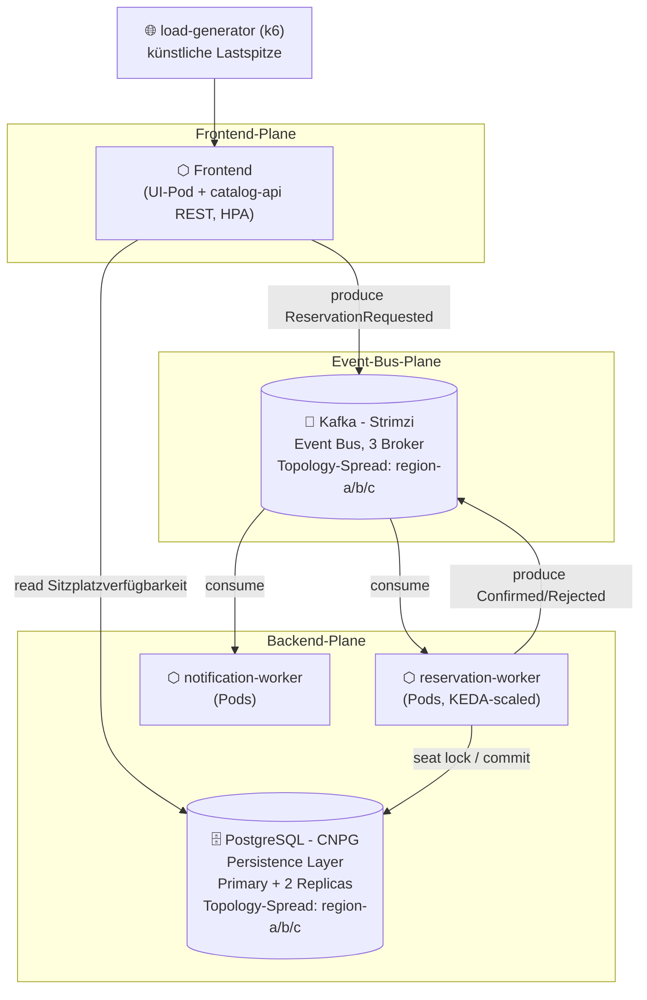

# TicketFlow

Cloud-native Ticketverkaufsplattform für Live-Events. Prüfungsleistung "Cloud Infrastructures and
Cloud Native Applications", DHBW. Dieses Dokument ersetzt den schriftlichen Bericht vollständig.

## ToDo

Pfisterer:
- Application
   - Frontend -> Philipp
   - API + Kafka Producer -> Philipp
   - Kafka Consumer -> Carlos
      - DB Schema aufbauen und über applikation versionieren
      - Event verarbeitung mit Reservierung des sitzplatzes, anschließend event ob successfull oder nicht
   - Message service -> Niklas
- Kafka Cluster -> Carlos
   - Schema Registry
   - Kafka Cluster
   - AKHQ als Oberfläche
- Postgres Cluster -> Niklas


Für alle Applikationen:
- Scheduling und Platzierung der Pods
- Resilienz der deployments
- Requests und Limits checken
- Helm Chart mit Values Schema

Bonus:
- Helm Charts
- Packaging von Helm Charts
- Kafka Strimzi
- Chaos Experiment

Screen Cast:
Alle Zusammen


- Observability mit OpenTelemetry
   - Logging
   - Metriken
   - evtl. Traces
- Autoscaler

Sturm:
Beleuchten Sie die ihnen zugeteilte Laborarbeit auf der Basis der in der Vorlesung
vermittelten theoretischen Grundlagen:
− Welche Vorteile und Nachteile ergeben sich für Ihre Anwendung aus der Realisierung
als Cloud Native? Zeigen Sie dabei auch alternative Realisierungsmöglichkeiten auf,
stellen Sie diese Ihrer Cloud Native Lösung gegenüber und erörtern Sie kritisch.
Unterlegen sie ihrer Argumentation mit konkreten Beispielen.
− Wie gewährleisten Sie die Datensicherheit? Bewerten Sie dabei auch die Relevanz der
DSGVO für Ihre Anwendung.
− Skizzieren und begründen Sie abschließend welche Cloud Native Pattern sich wo in
ihrer Anwendungsarchitektur wiederfinden.

Alea macht einen ersten Wurf
 

> **Status:** Repository-Grundgerüst. Diese README beschreibt die geplante und im Aufbau
> befindliche Architektur; Abschnitte, die noch nicht final implementiert sind, sind mit `TODO`
> markiert. Jeder Ordner enthält eine eigene README mit Detailplanung.

## Problem

Beim Vorverkauf populärer Events (Konzert, Stadion-Match) starten tausende Nutzer innerhalb
weniger Sekunden denselben Kaufversuch für eine kleine, feste Anzahl an Plätzen. Ein klassischer
synchroner CRUD-Ansatz (Request → sofortiger DB-Write) macht die Datenbank zum Flaschenhals:
Nutzer sehen Timeouts statt einer fairen Reihenfolge, und Plätze werden im Zweifel doppelt
vergeben (Overselling). TicketFlow trennt die *Annahme* einer Reservierungsanfrage von deren
*Verarbeitung* über einen Message Bus und skaliert die Verarbeitung anhand der Warteschlangenlänge
nach. Genau dieser Lastpfad – "viele gleichzeitige Reservierungen für ein knappes Kontingent" –
ist der fachliche Grund, warum Queue, Datenbank und Autoscaling hier tatsächlich gebraucht werden,
nicht nur vorgeführt.

## Architektur



**Datenfluss von der VM bis zum Pod:**

1. Terraform/OpenTofu erzeugt gegen den OpenStack-Provider der DHBWCloud vier VMs (1
   Control-Plane, 3 Worker) direkt am vorhandenen, extern routbaren Projektnetz `DHBWV6` – kein
   eigenes Netz, kein Router, keine selbst verwaltete Security Group — siehe
   [`infra/terraform/`](infra/terraform/). Jeder Worker erhält eine virtuell simulierte
   Regions-Metadata (`region-a`/`region-b`/`region-c`), da die DHBWCloud real nur eine
   Region/AZ bereitstellt.
2. Ansible konfiguriert die VMs, installiert k3s (Server auf der Control-Plane, Agents auf den
   Workern), übernimmt die simulierte Region als Kubernetes-Node-Label
   (`topology.ticketflow/region`) und bootstrapt ArgoCD — siehe [`infra/ansible/`](infra/ansible/).
3. ArgoCD übernimmt ab hier per GitOps (App-of-Apps) den Rest: CNPG-Operator, Strimzi-Operator,
   KEDA, kube-prometheus-stack und den TicketFlow-Helm-Chart selbst — siehe
   [`gitops/`](gitops/) und [`charts/ticketflow/`](charts/ticketflow/).
4. `catalog-api` nimmt Reservierungsanfragen entgegen und veröffentlicht sie als Event auf Kafka,
   statt synchron in die Datenbank zu schreiben.
5. `reservation-worker` konsumiert diese Events, sperrt den Sitzplatz transaktional in CNPG-Postgres
   und veröffentlicht das Ergebnis (bestätigt/abgelehnt) wieder auf Kafka.
6. `notification-worker` konsumiert das Ergebnis und simuliert eine Bestätigungs-Benachrichtigung.
7. Der `load-generator` erzeugt künstlich die namensgebende Lastspitze; Prometheus/Grafana machen
   Backlog, Fehlerquote und Replica-Anzahl sichtbar, KEDA reagiert auf den Kafka-Consumer-Lag.

Detailskizze und Screenshots des tatsächlichen Deployments folgen in
[`docs/architecture/`](docs/architecture/) (`TODO`, sobald der Cluster steht).

## Betrieb

> `TODO`: Sobald Terraform/Ansible/Charts final sind, exakte, kopierbare Befehle inkl. Beispielwerten
> hier verifizieren. Geplanter Ablauf:

### Eigenes Deployment (anderer Studierender / Dozent)

Dieses Repo gehört zu einer konkreten DHBW-Kennung (`cas438007`) und einem konkreten privaten
GitHub-Fork. Für ein eigenes Deployment davon abweichend:

1. **Repo forken/klonen** unter dem eigenen GitHub-Account (privat, siehe
   [`gitops/README.md`](gitops/README.md) ## Privates Repo).
2. **Personalisierbare, nicht-geheime Werte** (Fork-URL, DNS-Zone, ACME-E-Mail, TSIG-Keyname) an
   einer Stelle setzen statt in bis zu neun Dateien einzeln zu suchen:
   ```bash
   cp deploy.env.example deploy.env   # eigene Werte eintragen
   python3 scripts/personalize.py     # schreibt sie in gitops/**/*.yaml + charts/**/*.yaml
   git diff                           # pruefen, dann committen
   ```
   Jeder Wert lässt sich alternativ auch als Umgebungsvariable setzen (siehe
   `deploy.env.example`) — praktisch für CI oder um `deploy.env` gar nicht erst anzulegen.
3. **Secrets bleiben davon unberührt** (das Skript fasst nur getrackte, unkritische Werte an) —
   separat ausfüllen:
   - `infra/terraform/terraform.tfvars` (aus `.example`): eigene OpenStack-Application-Credentials.
   - `infra/ansible/secrets.yml` (aus `.example`): eigener RFC2136-TSIG-Secret-*Wert*.
   - `infra/ansible/argocd_deploy_key`: `ssh-keygen -t ed25519 -f infra/ansible/argocd_deploy_key
     -N ""`, Public Key als Read-only-Deploy-Key im eigenen Fork eintragen — siehe
     [`infra/ansible/README.md`](infra/ansible/README.md) ## GitOps-Secrets.
4. Ab hier der normale Ablauf unten (`terraform apply` → `ansible-playbook site.yml`).

```bash
# 1. Infrastruktur auf der DHBWCloud erzeugen
cd infra/terraform
cp terraform.tfvars.example terraform.tfvars   # OpenStack-Credentials/Projekt eintragen
terraform init
terraform apply

# 2. VMs konfigurieren, k3s-Cluster aufbauen, ArgoCD bootstrappen
cd ../ansible
ansible-inventory -i inventory/hosts.ini --list        # von Terraform-Output generiert
ansible-playbook -i inventory/hosts.ini playbooks/site.yml

# 3. Restliche Plattform per GitOps ausrollen (Operatoren, Kafka, Postgres, App)
export KUBECONFIG=./kubeconfig   # von Ansible aus der Control-Plane geholt
kubectl apply -f gitops/apps/app-of-apps.yaml

# 4. Rollout prüfen
kubectl get pods -A -o wide
kubectl get kafka,cluster.postgresql.cnpg.io -A

# 5. Künstlichen Lastpfad auslösen
cd ../../src/load-generator
k6 run flash-sale.js --env EVENT_ID=demo-event --env VUS=500

# 6. Beobachten
kubectl port-forward svc/kube-prometheus-stack-grafana 3000:80 -n monitoring
# -> Dashboard "TicketFlow Overview" öffnen
```

Ein frisch erzeugtes Projekt auf der DHBWCloud muss allein mit diesen Schritten (ohne manuelle
Portal-Klicks) zum laufenden Stack führen.

## Entscheidungen

Je Pflicht- und Wahlthema: Wahl, Alternative, Begründung. Referenzen auf konkrete Dateien sind
angegeben, wo bereits Code existiert; alles andere ist Planungsstand (siehe `TODO`-Markierungen
oben) und wird ergänzt, sobald es implementiert ist.

**P1 – Anwendung und Domäne.** *Wahl:* drei eigene, über das Netzwerk kommunizierende Services
(`catalog-api` per REST, `reservation-worker`/`notification-worker` per Kafka) plus zwei
zustandsbehaftete Dienste (CNPG-Postgres, Strimzi-Kafka); Container-Images werden aus je einem
Dockerfile pro Service in `src/*/` gebaut (umgesetzt für `notification-worker`, siehe
[`src/notification-worker/`](src/notification-worker/)). *Alternative:* ein Monolith mit
synchronem DB-Zugriff, oder nur die geforderten zwei Services ohne eigenen
Notification-Consumer. *Begründung:* Ein Monolith wäre schneller gebaut, würde die
Sitzplatzreservierung aber pro Request synchron in der DB verriegeln — genau der Engpass, den der
Flash-Sale-Lastpfad vermeiden soll. Der dritte Service ist kein Selbstzweck: erst eine zweite,
unabhängige Konsumentengruppe auf demselben Ergebnis-Topic beweist, dass Kafka hier als Bus mit
Fan-out genutzt wird und nicht nur als Punkt-zu-Punkt-Queue zwischen zwei Services — sonst wäre der
"zustandsbehaftete Dienst" nur eine Queue vor einer DB-Kopie.

**P2 – Infrastruktur als Code.** *Wahl:* Terraform/OpenTofu gegen den OpenStack-Provider für
VMs/Netz, Ansible für OS-Konfiguration und k3s-Bootstrap — ein `terraform apply` gefolgt von einem
`ansible-playbook site.yml` bringt den kompletten Stack hoch. *Alternative:* manuell im
DHBWCloud-Portal angelegte VMs, oder ein anderes IaC-Werkzeug (z. B. Pulumi) statt der
vorgeschlagenen Kombination. *Begründung:* Ein Portal-Klick wäre schneller, ließe sich aber nicht
reproduzieren und zählt laut Aufgabenstellung explizit nicht als Nachweis ("kein Klick im
Portal"); Managed Kubernetes ist auf der DHBWCloud ohnehin ausgeschlossen. Terraform+Ansible trennt
zusätzlich sauber "Ressourcen existieren" (Terraform, siehe
[`infra/terraform/`](infra/terraform/)) von "Ressourcen sind konfiguriert" (Ansible, siehe
[`infra/ansible/`](infra/ansible/)) — ein einzelnes Werkzeug für beides würde diese Trennung
verwischen und macht schwerer nachvollziehbar, welcher Schritt für einen fehlgeschlagenen Bootstrap
verantwortlich ist.

**P3 – Deployment und Konfiguration.** *Wahl:* Helm-Werte legen Requests/Limits je Service fest
(z. B. `notification-worker`: 25m/100m CPU, 32Mi/64Mi Memory — bewusst klein, weil der Dienst nur
Kafka-Konsum und kurze Log-/SMTP-Aufrufe macht, keine CPU-intensive Verarbeitung wie
`reservation-worker`; siehe [`charts/notification-worker/values.yaml`](charts/notification-worker/values.yaml)),
Images werden mit dem Git-SHA statt `:latest` getaggt, DB-Zugangsdaten/Kafka-Bootstrap-Server
kommen aus ConfigMap/Secret. *Alternative:* Werte im Image hart kodieren oder `:latest`
verwenden. *Begründung:* `:latest` macht Rollbacks unmöglich, weil unklar bleibt, welches Image zu
einem Zeitpunkt tatsächlich lief; Secrets im Image wären sowohl in der Registry einsehbar als auch
nicht pro Umgebung (dev/prod, siehe W1) austauschbar, ohne das Image neu zu bauen.

**P4 – Scheduling und Platzierung.** *Wahl:* Jeder Worker trägt ein Node-Label
`topology.ticketflow/region` (`region-a`/`region-b`/`region-c`, von Terraform als Metadata
vergeben und von Ansible in ein Kubernetes-Label übersetzt – die DHBWCloud stellt real nur eine
Region/AZ bereit, die Verteilung wird für diese Entscheidung bewusst simuliert). CNPG-Postgres
(Primary+2 Replicas) und die Kafka-Broker (Strimzi, 3 Broker) erhalten je eine
`topologySpreadConstraint`/`podAntiAffinity` auf diesem Label, sodass ihre Replicas nie auf
demselben simulierten Standort landen. *Alternative:* freie Platzierung durch den
Standard-Scheduler, oder ein einzelner dedizierter "Storage-Node" für beide Dienste.
*Begründung:* Freie Platzierung könnte alle Replicas eines Dienstes zufällig auf denselben Node
verteilen — der Ausfall genau dieses einen Nodes würde Ticket-Reservierungen und deren Event-Log
komplett verschwinden lassen. Ein einzelner Storage-Node wäre selbst wieder ein Single Point of
Failure und hätte die Platzierungsfrage nur verschoben statt aus der Domäne (Ausfallsicherheit
beim Ticketverkauf, nicht aus der Vorlesung) heraus beantwortet.

**P5 – Resilienz und Persistenz.** *Wahl:* Liveness/Readiness-Probes auf allen drei Services, CNPG
verwaltet PVCs für Primary+2 Replicas, Strimzi-Kafka-Broker laufen als StatefulSet mit PVC,
PodDisruptionBudgets sichern Rolling Updates ab (für `notification-worker` bereits umgesetzt:
`replicaCount: 3`, `minAvailable: 2`, siehe
[`charts/notification-worker/templates/poddisruptionbudget.yaml`](charts/notification-worker/templates/poddisruptionbudget.yaml)).
*Alternative:* `emptyDir` statt PVC, oder ein Single-Instance-Postgres ohne Replikation.
*Begründung:* `emptyDir` und ein Single-Instance-Postgres wären einfacher aufzusetzen, aber jeder
Pod-Neustart bzw. Node-Ausfall würde dann Reservierungsdaten unwiederbringlich löschen statt sie
nur kurz unerreichbar zu machen. Ticket-Reservierungen sind Geschäftsdaten; ein Pod-Verlust darf
keine Bestellung verlieren, ein Rolling Update der API darf keine Downtime verursachen.

**P6 – Skalierbarkeit.** *Wahl:* KEDA skaliert `reservation-worker` auf Basis des
Kafka-Consumer-Group-Lags. *Alternative:* HPA auf CPU-Auslastung. *Begründung:* Die eigentliche
fachliche Engpassgröße ist "wie viele Reservierungen warten auf Verarbeitung", nicht CPU-Last —
CPU kann bei I/O-gebundener Arbeit (Warten auf DB-Commit, Kafka-Fetch) trügerisch niedrig bleiben,
obwohl die Warteschlange wächst und Kunden auf ihre Bestätigung warten. Der Trade-off: eine
Lag-basierte Metrik braucht einen zusätzlichen Scaler/Adapter (KEDA) statt der im Cluster bereits
eingebauten HPA-CPU-Metrik — der Mehraufwand lohnt sich hier, weil CPU-Skalierung im Lasttest
schlicht am falschen Signal skalieren würde.

**P7 – Observability.** *Wahl:* Jeder Service exponiert `/metrics` (Prometheus-Client). Wo ein
Service von anderen Pods über eine `Service`-Ressource erreichbar sein muss, wird per
`ServiceMonitor` gescraped (`catalog-api`, `reservation-worker`, geplant); wo es — wie bei
`notification-worker` — keinen anderen Konsumenten der HTTP-Endpunkte gibt (reiner
Kafka-Consumer, keine eingehenden Requests), entfällt die `Service`-Ressource zugunsten eines
direkt auf die Pod-Labels zielenden `PodMonitor` (bereits umgesetzt, siehe
[`charts/notification-worker/templates/podmonitor.yaml`](charts/notification-worker/templates/podmonitor.yaml)).
CNPG und Strimzi bringen eigene Metriken mit, ein Grafana-Dashboard liegt als Code
(`observability/dashboards/`) vor, eine Alert-Regel feuert auf "Reservation-Backlog über
Schwellwert für 5 Minuten". *Alternative:* Ad-hoc-Logging ohne Metriken, oder überall
`ServiceMonitor` samt unbenutzter `Service`-Ressource statt `PodMonitor`. *Begründung:* Ohne
Metriken lässt sich P6 nicht demonstrieren — KEDA braucht eine abfragbare Zeitreihe, kein
Log-Grepping. Eine unbenutzte `Service`-Ressource nur für den Scraper wäre reine Zeremonie; die
Alert-Regel macht zusätzlich sichtbar, ab wann die Lastspitze geschäftlich relevant wird
(Kunden warten spürbar), nicht nur technisch (Lag-Zahl steigt).

**W1 – Packaging (Helm).** *Wahl:* ein Umbrella-Chart `charts/ticketflow` mit
`values-dev.yaml`, `values-prod.yaml` und `values.schema.json` (Muster bereits im ersten
Service-Chart etabliert, siehe [`charts/notification-worker/values.schema.json`](charts/notification-worker/values.schema.json)).
*Alternative:* Kustomize mit Base+Overlays. *Begründung:* Kustomize kennt kein Werte-Schema — ein
vergessener oder falsch typisierter dev-Wert (z. B. eine String- statt Int-Replica-Zahl) fiele
erst zur Laufzeit im Cluster auf. Mit Helm+`values.schema.json` schlägt `helm lint`/`helm install`
schon vorher fehl, bevor eine falsch konfigurierte CNPG-`Cluster`- oder Strimzi-`Kafka`-Resource
überhaupt angewendet wird — bei zustandsbehafteten Custom Resources ist das der relevantere
Fehlerzeitpunkt.

**W2 – GitOps.** *Wahl:* ArgoCD mit App-of-Apps-Pattern, Auto-Sync und Self-Heal.
*Alternative:* reines `kubectl apply`/eine CI-Pipeline ohne Cluster-seitigen Agenten.
*Begründung:* Ansible bootstrappt bewusst nur so viel, dass ArgoCD läuft; alles danach (Operatoren,
Kafka, Postgres, App) kommt aus Git. Der Trade-off: eine reine CI-Pipeline hätte keinen laufenden
Agenten im Cluster, der Drift erkennt — eine manuell (z. B. während eines Incidents) geänderte
Replica-Zahl bliebe bestehen, bis zufällig die nächste Pipeline läuft, statt automatisch per
Self-Heal zurückgedreht zu werden. Für ein Laborsetup mit mehreren Bearbeitern, die versehentlich
`kubectl edit` statt eines Commits benutzen könnten, ist genau das der relevante Fall.

## Grenzen

- Die DHBWCloud stellt nur eine begrenzte Anzahl VMs/Ressourcen bereit; CNPG- und Kafka-Replikation
  sind daher klein dimensioniert (nicht produktionsreif für echte Lastspitzen mit Millionen Nutzern).
- Zahlungsabwicklung ist simuliert (kein echtes Payment-Gateway); `notification-worker` kann
  optional per SMTP echte E-Mails versenden, fällt aber standardmäßig (kein SMTP-Relay im
  Demo-Betrieb konfiguriert) auf reine Log-Ausgabe statt echtem E-Mail/SMS-Versand zurück.
- k3s statt eines vollwertigen Kubernetes verkleinert den Kontrollebenen-Fußabdruck, verhält sich
  aber nicht in jedem Detail wie ein Cloud-Provider-Kubernetes.
- Der Lastgenerator bildet einen synthetischen "alle klicken gleichzeitig"-Fall nach; reales
  Nutzerverhalten (Netzwerklatenz-Verteilung, Retry-Verhalten von Browsern) ist nicht modelliert.
- Ein Node-Ausfall der Control-Plane ist nicht automatisch behoben (kein HA-Control-Plane geplant);
  das ist eine bewusste Kosten/Nutzen-Entscheidung für den Laborrahmen.

*(TODO: nach Lasttests unter echten Bedingungen konkretisieren, was tatsächlich beobachtet wurde.)*

## Bonus

> `TODO`: Beide Leistungen sind unten als Plan beschrieben, aber noch **nicht umgesetzt** — dieser
> Abschnitt wird erst final in der Abgabe stehen bleiben, wenn Nachweis im Betrieb existiert
> (Aufgabenstellung: "ein erfüllter Haken allein reicht nicht, es zählt die Tiefe"). Bis dahin dient
> er als Umsetzungsplan; Verweise auf Dateien werden ergänzt, sobald sie existieren.

**B1 – Drittes Wahlthema: W7 Cluster-Härtung.** *Was getan werden soll:* Deny-by-default
Network Policies je Namespace (`kafka`, `cnpg-system`, künftiger `ticketflow`-App-Namespace) plus
explizite Allow-Regeln für die tatsächlich benötigten Pfade — `catalog-api`/`reservation-worker` →
CNPG-Primary auf Port 5432, `catalog-api`/`reservation-worker`/`notification-worker` → Kafka-Broker
auf 9092/9093, Prometheus → `/metrics` auf allen drei Services, ArgoCD → Kubernetes-API-Server.
Drei Charts haben ein solches Netzwerk-Policy-Netz bereits scope-geprüft aktiv (`cert-manager`,
`kube-prometheus-stack`, `tempo`, siehe `charts/README.md` ## Resource-Limits, Security-Context,
NetworkPolicy); CNPG, Strimzi, Longhorn und `external-dns` bringen aber kein eigenes
`networkPolicy`-Feld mit (dort müssten die Policies selbst geschrieben werden) und
`notification-worker`/`loki` haben ihr Toggle bewusst noch aus. Dazu: die bislang rein
gitignoreten `infra/ansible/secrets.yml` (RFC2136-TSIG) und `infra/ansible/argocd_deploy_key`
werden SOPS-verschlüsselt (age-Backend) eingecheckt statt nur lokal zu existieren und
out-of-band verteilt zu werden — Ansible entschlüsselt sie zur Laufzeit über ein
`community.sops`-Lookup-Plugin, ein `.sops.yaml` legt fest, welche Felder verschlüsselt werden.
*Alternative:* Sealed Secrets (Controller-basiert) oder Vault (eigener Dienst) statt SOPS.
*Begründung:* Sealed Secrets bräuchte einen zusätzlichen, selbst zu betreibenden
zustandsbehafteten Controller nur für diesen einen Zweck; Vault wäre für ein Laborsetup mit
überschaubarer Secret-Zahl deutlich überdimensioniert. SOPS verschlüsselt einzelne Dateien ohne
zusätzlichen Cluster-Dienst und passt zum bestehenden Muster
(`secrets.yml.example`/`terraform.tfvars.example`) — die verschlüsselte Datei kann committet
werden, ohne das bisherige `delegate_to: localhost`-Modell von `gitops_secrets` zu ändern.
*Nachweis im Betrieb (geplant):* `kubectl describe networkpolicy -A` zeigt die Deny-by-default-
Policies; ein Pod ohne passendes Label kann nachweislich **nicht** gegen CNPG:5432 oder den
Kafka-Broker verbinden (negative Probe); `git show` zeigt die SOPS-verschlüsselte
`secrets.yml`, `sops -d` (nur mit dem richtigen age-Key) das Klartext-Ergebnis.

**B2 – Neue Technologie: Kafka-Betrieb mit Strimzi über den Beispielumfang der Vorlesung
hinaus.** *Was getan werden soll:* Statt eines einzigen, cluster-weit geteilten Kafka-Credentials
für alle drei Services bekommt jeder Service über Strimzis **User Operator** eine eigene
`KafkaUser`-Custom-Resource mit SCRAM-SHA-512-Authentifizierung (das zugehörige Secret erzeugt
der Operator automatisch) und ein eigenes, engst mögliches `spec.authorization`
(`type: simple`, ACLs): `catalog-api` darf nur `Write` auf `reservation-requests`, kein `Read`;
`reservation-worker` darf `Read` auf `reservation-requests` und `Write` auf
`reservation-results`; `notification-worker` darf ausschließlich `Read` auf
`reservation-results`. Ergänzend läuft **AKHQ** (schreibgeschützt konfiguriert) als Kafka-Ops-UI
im Cluster — Topics, Partitionen und Consumer-Group-Lag live einsehbar, ursprünglich bereits im
Team-ToDo für die Kafka-Cluster-Aufgabe vorgesehen. *Alternative:* ein einziges, geteiltes
Client-Secret für alle Producer/Consumer (der in der Vorlesung/GridFlex gezeigte Umfang), oder
Kafka-ACLs händisch per `kafka-acls.sh` statt deklarativ über `KafkaUser`. *Begründung:* Ein
geteiltes Secret ist funktional ausreichend, um Nachrichten zu produzieren/konsumieren, macht
aber jeden der drei Services implizit zu einem Producer/Consumer auf *jedem* Topic — ein Bug in
`notification-worker` könnte dann unbemerkt in `reservation-results` schreiben und stille
Dateninkonsistenz erzeugen, statt sofort mit einer `TopicAuthorizationException` abgelehnt zu
werden. Händische `kafka-acls.sh`-Aufrufe wären nicht GitOps-versioniert und müssten bei jedem
Cluster-Rebuild manuell wiederholt werden; `KafkaUser` als Custom Resource kommt wie alles andere
aus Git und wird von ArgoCD mitverwaltet (siehe W2). *Tragend, nicht dekorativ:* Die ACLs ändern
das tatsächliche Fehlerverhalten bei einem Bug (harter Autorisierungsfehler statt stiller
Fehlschreibung) und sind damit Teil des Resilienz-/Datensicherheits-Arguments aus ## Grenzen, nicht
nur eine zusätzliche Konfigurationsdatei. *Nachweis im Betrieb (geplant):* `kubectl get kafkauser
-n kafka` zeigt die drei Nutzer; ein absichtlich falsch konfigurierter Test-Producer (z. B. ein
`kubectl run`-Pod mit `notification-worker`s Credentials, der versucht auf
`reservation-requests` zu schreiben) wird von Kafka mit einer Autorisierungs-Exception abgelehnt
— eine Screencast-taugliche Negativprobe; AKHQ zeigt die drei Consumer-Groups mit wachsendem/
fallendem Lag live während der P6-Lastdemo.
